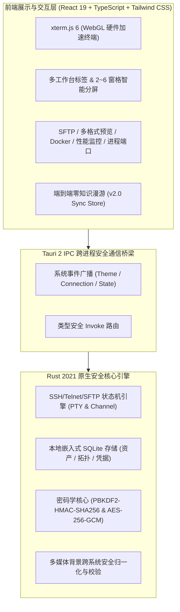

<div align="center">

# Qshell

### 🚀 现代化极速桌面终端与多协议服务器管理工作台

[](https://github.com/Tomshushu/Qshell/releases)
[](https://tauri.app/)
[](https://react.dev/)
[](https://www.rust-lang.org/)
[](./LICENSE)
[]()

**轻量极速 · 零知识云漫游 · 全协议支持 · 多维运维集成 · 免 Agent 监控 · 企业级密码学保障**

[下载最新发行版](https://github.com/Tomshushu/Qshell/releases) · [贡献指南](./CONTRIBUTING.md) · [发版标准 SOP](./RELEASE_GUIDE.md) · [报告 Bug](https://github.com/Tomshushu/Qshell/issues)

</div>

---

## 📖 项目简介 (Introduction)

**Qshell** 是一款面向开发者、系统管理员与 DevOps 工程师精心打造的**现代化极速桌面服务器运维与多协议工作台**。

项目摒弃了传统 Electron 应用高内存、高延迟的弊端，基于 **Tauri 2 + Rust + React 19** 构建，以原生硬件性能驱动终端交互。Qshell 将主机资产树、多协议终端（SSH / Telnet / RDP / BMC Redfish）、带断点续传的 SFTP 文件管理、零侵入系统指标监控、Docker 容器编排、全格式文档实时预览与**端到端零知识加密（E2EE）全量配置漫游**深度融合于同一个优雅直观的工作台中。

---

## 🌟 核心特性与亮点 (Key Features)

### 1. ⚡ 极致性能与现代桌面架构
- **Rust 驱动的原生内核**：内存占用较传统 Electron 终端降低 **70%+**，冷启动秒开，极致轻巧。
- **WebGL 硬件加速渲染**：基于 xterm.js 与 GPU 渲染引擎，支撑 100,000+ 行高频滚动日志，杜绝主线程卡顿与掉帧。
- **持久化会话保护**：支持多工作台标签不设上限切换、2～6 窗格多路分屏、会话广播与跨窗口拖拽，布局切换时终端实例与输入历史永不丢失。

### 2. 🔐 零知识全量端到端云漫游 (Zero-Knowledge E2EE Sync v2.0)
- **多维度资产无感漫游**：完整同步服务器配置与凭据、树状分组拓扑、SSH 密钥对库、分类标签、已知主机信任指纹 (`Known Hosts`)、常用命令收藏库 (`Quick Commands`) 以及日志关键词书签。
- **多媒体背景与个性化习惯漫游**：首次支持终端自定义背景壁纸与动态视频同步，通过虚拟协议 `media://` 抹平跨操作系统路径差异；本地 UI 风格、终端字体字号、主题配色、快捷连接历史与命令执行历史换机一键无缝还原。
- **企业级密码学保障**：
  - **NIST SP 800-132**：采用 `PBKDF2-HMAC-SHA256`（100,000 次高强度迭代 + 16 字节高熵随机 Salt）派生密钥；
  - **NIST SP 800-38D**：`AES-256-GCM` 全包认证加密与 16 字节完整性标签防篡改；
  - **零知识原则**：主密码永不上云，第三方平台（GitHub / Gitee 私有仓）仅持有高强度密文信封；支持脱敏模式（可选择不同步明文密码）。

### 3. 🖥️ 全协议资产管理与灵活认证
- **全协议栈覆盖**：
  - **Linux / Unix**：SSH 终端、SFTP 双向管理与系统全量深度运维；
  - **网络设备 (Switch/Router)**：支持 SSH 与交互式 Telnet 会话；
  - **Windows 目标**：便捷调用系统原生 RDP 客户端；
  - **服务器带外管理 (BMC)**：Redfish over HTTPS 协议，硬件状态与电源远程控制。
- **多层次安全认证**：支持密码、加密私钥（Passphrase）、SSH Agent 身份枚举、OpenSSH 用户证书认证以及跳板机链式代理（ProxyJump）。

### 4. 📁 现代化 SFTP 与全格式开箱即用预览
- **高性能双向传输**：支持文件夹拖拽上传、多任务并发传输、断点续传、文件权限属性调整与后台传输任务管理。
- **开箱即用多格式原生预览**：无须依赖第三方外部软件，直接在应用内快速预览：
  - 📄 **文档文件**：Word (`.docx`)、Excel (`.xlsx`)、PowerPoint (`.pptx`)、PDF、Markdown；
  - 🖼️ **图片与矢量图**：PNG, JPG, WEBP, GIF, SVG, BMP, HEIC, PSD 等；
  - 📦 **主流压缩包**：Zip, Tar, Gz, 7z, Xz 归档目录树交互式展开与解压；
  - 📝 **代码与日志**：支持多种主流编程语言语法高亮与轻量级在线快速编辑。

### 5. 📊 免 Agent 深度系统感知与运维工具箱
- **无侵入式监控**：远端无需部署任何额外守护进程或 Agent，基于安全 SSH 管道实时采集 CPU、内存、磁盘 IO、网络吞吐。
- **进程与端口拓扑**：实时监测远端进程资源占用、结束进程；可视化探测本地与远端监听端口和网络连接分布。
- **Docker 容器生命周期管理**：查看容器列表、实时状态、日志流式输出、启动/停止/重启容器，免去手工键入繁琐指令。

### 6. 🛡️ 企业级安全堡垒与隐私控制
- **全能应用锁 (Application Lock)**：支持密码锁与九点图案锁双模式，空闲自动加锁，断开敏感会话保障机密安全。
- **危险操作防御**：多行代码与大文本粘贴二次安全确认，有效防范黑客反弹 Shell 隐蔽脚本攻击。
- **主机指纹防伪校验**：严格验证 SSH Host Key，支持一键重置与信任指纹管理，阻断中间人攻击 (MITM)。

---

## 🏗️ 架构概览 (Architecture)



---

## 📦 安装与下载 (Download & Installation)

Qshell 为各大主流操作系统提供了开箱即用的安装包与绿色免安装版：

| 操作系统 | 推荐安装格式 | 支持架构 | 备注 |
| :--- | :--- | :--- | :--- |
| **Windows** | `.exe` (NSIS 安装包) | x86_64 / x64 | 推荐 Win 10 / 11 |
| **macOS** | `.dmg` | Universal (Apple Silicon M 系列 & Intel) | 拖拽至 Applications 即可 |
| **Linux** | `.AppImage` / `.deb` | x86_64 / amd64 | 赋予执行权限即可直接运行 |

👉 **[前往 GitHub Releases 官方发布页下载最新版本](https://github.com/Tomshushu/Qshell/releases)**

> **OTA 在线升级**：Qshell 客户端内置了 GitHub 与 Gitee 双源智能测速引擎，在【设置】->【检查更新】中可一键探测新版本并差量升级。

---

## 🛠️ 本地开发与构建 (Local Development)

如果你希望在本地运行或参与功能开发，请遵循以下步骤：

### 1. 前置依赖准备
- **Node.js**：`>= 18.0.0`
- **Rust 工具链**：`rustc >= 1.80` 与 `cargo`（[rustup.rs](https://rustup.rs/)）
- **C++ 编译环境**：
  - Windows: Visual Studio C++ Build Tools & WebView2
  - macOS: Xcode Command Line Tools (`xcode-select --install`)
  - Linux: `libwebkit2gtk-4.1-dev build-essential curl wget libssl-dev libudev-dev`

### 2. 获取代码与启动
```bash
# 1. 克隆代码仓库
git clone https://github.com/Tomshushu/Qshell.git
cd Qshell

# 2. 安装前端依赖
npm install

# 3. 启动桌面端热重载开发模式
npm run dev:tauri
```

### 3. 代码质量门禁验证
```bash
# 执行 Rust 编译检查
cargo check --manifest-path src-tauri/Cargo.toml

# 执行 TypeScript 静态类型检查
npx tsc --noEmit

# 执行未定义标识符拦截检查
npm run check:undefined

# 运行全量单元测试与集成测试
npx vitest run

# 执行生产环境打包预演
npm run build
```

---

## 🤝 参与贡献 (Contributing)

我们非常欢迎社区开发者为 Qshell 贡献代码或提出想法！

- **提交 Issue**：报告 Bug 或提出新需求，请直接使用我们的 [Issue 模板](https://github.com/Tomshushu/Qshell/issues/new/choose)。
- **提交 PR**：在发起代码合并请求前，请详细阅读 [**开源贡献指南 (CONTRIBUTING.md)**](./CONTRIBUTING.md)。
- **发版标准**：核心维护者发版请严格遵守 [**发版标准作业程序 (RELEASE_GUIDE.md)**](./RELEASE_GUIDE.md)。

---

## 📄 开源许可证 (License)

本项目采用 [Apache License 2.0](./LICENSE) 协议开源。你可以自由商用、修改与分发，同时享有专利保障，版权归 Qshell 社区所有。
