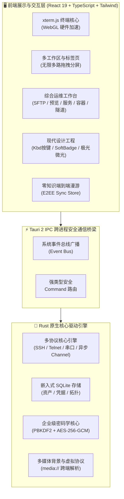

<div align="center">

<p align="center">
  
</p>

# Qshell

### 🚀 现代化极速桌面终端与多协议服务器管理工作台

[](https://github.com/Tomshushu/Qshell/releases)
[](https://gitee.com/Tom-shushu/qshell/releases)
[](https://tauri.app/)
[](https://react.dev/)
[](https://www.rust-lang.org/)
[](./LICENSE)


**轻量极速 · 本地马尔可夫预测 · 现代极客美学 · 零知识云漫游 · 全协议支持 · 免 Agent 监控**

[⚡ Gitee 国内极速下载](https://gitee.com/Tom-shushu/qshell/releases) · [🌐 GitHub Releases](https://github.com/Tomshushu/Qshell/releases) · [✨ 核心亮点](#-为什么选择-qshell-highlights) · [📖 功能特性](#-核心特性与亮点-key-features) · [📦 安装指南](#-安装与下载-download--installation) · [🤝 参与贡献](./CONTRIBUTING.md)

</div>

---

## ✨ 为什么选择 Qshell？ (Highlights)

Qshell 致力于打造一款**轻巧、敏捷、安全且全能**的新一代服务器管理工作台，将终端交互与日常运维场景无缝融合：

- ⚡ **极致轻量 · 原生性能**  
  基于 Tauri 2 + Rust 原生安全核心驱动，日常运行内存仅需 **~60MB**，冷启动毫秒级秒开；终端依托 xterm.js 与 WebGL 硬件加速引擎，支撑 100,000+ 行高频滚动日志，杜绝卡顿与掉帧。

- 🧠 **本地马尔可夫链指令预测与 OSC-7 目录感知**  
  基于一阶马尔可夫状态转移概率模型与终端 OSC-7 协议，**0ms 本地计算、0 Token 开销、100% 数据离线保密**。内置 Git、Docker、Systemd 等 7 大高频工程连招与动态参数槽位回填（如 `mkdir` 自动推断 `cd <dir>`），并伴随个人击键习惯自主在线学习，按 <kbd>Tab</kbd> 极速一键采纳。

- 🎨 **对标顶奢的极客设计工程 (Linear, Raycast & Cursor UI Standards)**  
  全栈重构视觉与微交互体验：沉浸式 Raycast 触感 `<Kbd>` 实体按键卡片、Linear 级柔和微透状态徽章（Soft Badges）搭配 `status-dot-pulse` 动态呼吸指示灯、双层发丝级微光倒角与浮动 HUD 深度阴影；全局数字防抖（`tabular-nums`），彻底杜绝速率与性能指标的数值晃动。

- 📁 **现代化 SFTP 目录重构与全格式开箱原生预览**  
  高集成度 SFTP 文件管理系统，配备全新 Raycast 风格的微药丸双栏路径导航（Capsule Breadcrumbs）、纯净无竖线发丝表格、专属 `FolderUp` 上级引导行与并发递归传输池；更首创免外部第三方软件直接预览 Word (`.docx`)、Excel (`.xlsx`)、PPT (`.pptx`)、PDF、代码语法高亮与各类压缩包归档。

- 🖥️ **一站式多协议资产枢纽**  
  原生覆盖 **SSH、Telnet、工业级 Serial 串口、Windows 原生 RDP 与带外管理 BMC Redfish** 协议，支持多级链式跳板（ProxyJump）、SSH 隧道端口转发、信创国产化操作系统适配与树状分组拓扑，满足从云端主机到机房硬件的全场景连接。

- 📊 **免 Agent 深度系统感知与运维**  
  告别在远端服务器部署侵入式常驻 Agent 的繁琐。基于安全 SSH 管道，开箱即得 CPU、内存细分、磁盘 IO、网络吞吐动态仪表盘；并深度集成 **Systemd 系统服务管理**（含 journalctl 实时日志）、进程资源拓扑与 **Docker 容器生命周期**一键管理。

- 🔐 **零知识 E2EE 端到端全量漫游**  
  依托 Gitee / GitHub 私有仓库实现跨设备即时漫游。采用 `PBKDF2-HMAC-SHA256 + AES-256-GCM` 军工级密码学保障，主密码与凭据**永不上云**，安全漫游主机资产、凭据库、标签拓扑乃至个性化终端动态壁纸。

- 🛡️ **自由分屏与无缝交互**  
  支持**无上限任意多路拖拽分屏**、独立多工作区切换、标签锁定与彩色标记、动态视频背景跨端解析；终端选区复制即刻消失无干扰，兼具生产力效率与赏心悦目的操作体验。

---

## 📖 项目简介 (Introduction)

**Qshell** 是一款面向开发者、系统管理员与 DevOps 工程师精心打造的**现代化极速桌面服务器运维与多协议工作台**。

项目采用极简轻量的高性能桌面架构，基于 **Tauri 2 + Rust + React 19** 构建，以原生硬件性能驱动终端交互。Qshell 将主机资产树、多协议终端（SSH / Telnet / Serial / RDP / BMC Redfish）、带并发断点续传的 SFTP 文件管理、零侵入系统指标监控、Systemd 服务管理、Docker 容器编排、SSH 隧道转发、全格式文档实时预览与**端到端零知识加密（E2EE）全量配置漫游**深度融合于同一个优雅直观的工作台中。

---

## 🌟 核心特性与亮点 (Key Features)

### 1. ⚡ 极致性能与现代桌面架构
- **Rust 驱动的原生内核**：内存占用较常规终端降低 **70%+**，冷启动秒开，极致轻巧。
- **WebGL 硬件加速渲染**：基于 xterm.js 与 GPU 渲染引擎，支撑 100,000+ 行高频滚动日志，杜绝主线程卡顿与掉帧。
- **无限层级自由分屏 (Unlimited Split Panes)**：
  - **无窗格数量上限**：基于二叉树动态布局，支持将任意标签页拖拽到目标窗格的上下左右边缘进行递归嵌套切分；
  - **弹性视口调整**：窗格间支持鼠标拖拽实时调节比例（带最小视口保护），适应多屏超宽带显示需求；
- **多工作区与标签保护**：支持多工作区（Workspace）独立隔离、标签页会话克隆（Duplicate）、标签重命名、防误触加锁（Lock）与自定义彩色标记；会话广播与跨窗口拖拽，布局切换时终端实例与输入历史永不丢失。

### 2. 🧠 本地马尔可夫链指令预测与 OSC-7 目录感知 (Markov Command Intelligence & CWD Context)
- **0ms 极速本地推断 · 零 Token 开销**：
  - 彻底规避云端大模型网络往返延迟（RTT）与 Token 配额限制，**100% 运行于端侧本地**；
  - 严格离线保密，无需配置 API Key，即使在断网环境或高等级保密机房依然丝滑可用。
- **内置黄金工程连招拓扑 (Built-in Workflow Priors)**：
  - **Git 极速连招**：`git add .` $\xrightarrow{96\%}$ `git commit -m ""` $\xrightarrow{94\%}$ `git push`；`git pull` $\rightarrow$ `npm/pnpm install`；`git checkout -b <branch>` $\rightarrow$ `git push -u origin <branch>`；
  - **Docker & 容器编排**：`docker-compose down` $\xrightarrow{94\%}$ `docker-compose up -d` $\rightarrow$ `docker-compose logs -f`；`docker build` $\rightarrow$ `docker run -d`；
  - **Systemd 系统服务管理**：`systemctl restart <svc>` $\xrightarrow{96\%}$ `systemctl status <svc>` $\rightarrow$ `journalctl -u <svc> -f`；
  - **目录与自动化归档**：`tar -zxvf <pkg>` / `unzip <pkg>` $\rightarrow$ `cd <解压目录>`；`df -h` $\rightarrow$ `du -sh * | sort -hr | head -n 10`；`nginx -t` $\rightarrow$ `systemctl reload nginx`。
- **动态参数槽位抽取与回填 (Slot Extraction & Propagation)**：
  - 告别死板命令补全，能够智能捕获前序指令中的参数（如路径、服务名、容器名、分支名）；
  - 例如上一步执行 `mkdir -p /data/app_v2`，下一步敲入 `c` 自动提取路径并预测 `cd /data/app_v2`，按 <kbd>Tab</kbd> 一键成型。
- **OSC-7 协议驱动的实时工作目录 (CWD) 感知**：
  - 深度支持终端 OSC-7（Operating System Command 7）协议，实时毫秒级捕获远端 Shell 当前工作目录；
  - 依据目录环境进行上下文隔离与加权（如 `/var/log` 下优先推荐日志跟踪命令，代码仓库下优先推荐构建与 Git 连招）。
- **端侧自适应强化学习与时效衰减 (Online Self-Learning & Recency Decay)**：
  - 每次在终端按回车提交命令，本地自动学习并加权连续命令转移对；
  - 即使是企业专属私有脚本或自定义构建命令，执行 1~2 次后即可永久沉淀为你的个人专属预测；配合时间半衰期自动遗忘陈旧命令，越用越贴合你的肌肉记忆。

### 3. 🎨 现代设计工程与桌面级微质感 (Modern Design System & Tactile Engineering)
- **实体触感按键系统 (Tactile Keycaps)**：原生级 `<Kbd>` 规范，带有顶部微倒角高光与暗色浮雕微边框，在设置面板、快捷键说明、AI 交互与目录导航中全面统一。
- **Linear 级状态微徽章 (Soft Badges & Pulse Dots)**：告别高饱和度刺眼色块，采用柔和微透背景与 `status-dot-pulse` 动态呼吸微光，清晰区分在线、监听、传输中、故障与停止状态。
- **发丝级双层微光层级 (Hairline Glassmorphism)**：全局命令面板 (⌘K)、终端搜索 HUD、右键菜单与上下文弹窗注入 `inset 0 1px 0` 顶部发丝内高光与多层抗锯齿悬浮软阴影。
- **Cursor 极光微光氛围 (Subtle Aurora Glow)**：AI 助手与核心工作区注入深邃暗色极光氛围，科技感十足且视觉柔和耐看。
- **全局数字防抖 (Tabular Figures)**：SFTP 传输速率、进程监控（PID/CPU/MEM/VSZ/RSS）、串口收发吞吐与终端搜索计数全量注入 `font-mono tabular-nums`，彻底杜绝字符宽度跳变带来的视觉疲劳。

### 4. 📁 现代化 SFTP 与全格式开箱即用原生预览
- **微药丸双栏路径导航 (Capsule Breadcrumbs)**：每一个路径层级均为圆角悬浮胶囊，当前活跃末级目录高亮并携带展开文件夹微图标 (`FolderOpen`)，支持根路径与磁盘驱动器一键选择切换。
- **极简发丝排版与专属上级导航**：彻底摒弃传统 Excel 风格的纵向分割竖线，采用纯净水平发丝排版；独立的 `FolderUp` 上级引导行与 `<Kbd>Alt+↑</Kbd>` 快捷提示，避免误触重命名。
- **递归目录高并发传输池 (Worker Pool)**：深度优化文件夹递归扫描与并发上传/下载任务并发池，实时传输吞吐率高精平滑估算。
- **开箱即用多格式原生预览**：无须依赖第三方外部软件，直接在应用内快速预览：
  - 📄 **文档文件**：Word (`.docx`)、Excel (`.xlsx`)、PowerPoint (`.pptx`)、PDF、Markdown；
  - 🖼️ **图片与矢量图**：PNG, JPG, WEBP, GIF, SVG, BMP, HEIC, PSD 等；
  - 📦 **主流压缩包**：Zip, Tar, Gz, 7z, Xz 归档目录树交互式展开与快速解压；
  - 📝 **代码与日志**：支持多种主流编程语言语法高亮与轻量级在线快速编辑保存。

### 5. 🔐 零知识全量端到端云漫游 (Zero-Knowledge E2EE Sync)
- **多维度资产无感漫游**：完整同步服务器配置与凭据、树状分组拓扑、SSH 密钥对库、分类标签、已知主机信任指纹 (`Known Hosts`)、常用命令收藏库 (`Quick Commands`) 以及日志关键词书签。
- **多媒体背景与个性化习惯漫游**：首次支持终端自定义背景壁纸与动态视频同步，通过虚拟协议 `media://` 抹平跨操作系统路径差异；本地 UI 风格、终端字体字号、主题配色、快捷连接历史与命令执行历史换机一键无缝还原。
- **企业级密码学保障**：
  - **NIST SP 800-132**：采用 `PBKDF2-HMAC-SHA256`（100,000 次高强度迭代 + 16 字节高熵随机 Salt）派生密钥；
  - **NIST SP 800-38D**：`AES-256-GCM` 全包认证加密与 16 字节完整性标签防篡改；
  - **零知识原则**：主密码与明文凭据永不上云，第三方托管（GitHub / Gitee 私有仓库）仅持有高强度密文信封；本地全量端到端加密同步资产与配置，支持 Token 与主密码一键安全复制。

### 6. 🖥️ 全协议资产管理与灵活认证
- **全协议栈覆盖**：
  - **Linux / Unix / 信创系统**：SSH 终端、SFTP 双向管理，深度适配统信 UOS、麒麟 Kylin 等国产操作系统；
  - **网络硬件与串口 (Serial / COM)**：完备的工业级串口调试终端（波特率、数据位、停止位、流控、HEX/ASCII 双模、CRC 校验、DTR/RTS 信号监测、VID/PID 稳定重连）与 Telnet 会话；
  - **Windows 目标**：便捷调用系统原生 RDP 客户端；
  - **服务器带外管理 (BMC)**：Redfish over HTTPS 协议，硬件状态与电源远程开关/重启。
- **SSH 隧道与端口转发 (Tunneling)**：
  - 内联支持本地转发（Local `-L`）、远程转发（Remote `-R`）与动态 SOCKS5 代理转发（Dynamic `-D`），随服务器连接自动建立。
- **多层次安全认证**：支持密码、加密私钥（Passphrase）、SSH Agent 身份枚举、OpenSSH 用户证书认证以及多级链式跳板代理（Multi-Hop ProxyJump）。
- **资产安全防误触**：内置服务器回收站（Recycle Bin），支持软删除与一键找回。

### 7. 📊 免 Agent 深度系统感知与运维工具箱
- **无侵入式监控**：远端无需部署任何额外守护进程或 Agent，基于安全 SSH 管道实时采集 CPU、内存细分、磁盘 IO、网络吞吐与 TCP 重传率。
- **Systemd 系统服务管理**：图形化启停、重启、重载 Linux 系统服务，管理开机自启（enabled/disabled），查看服务实时 CPU/内存与 `journalctl` 实时流式日志。
- **进程与端口拓扑**：实时监测远端进程树资源占用、按 CPU/内存排序，PID 冲突校验防误杀；可视化探测本地与远端监听端口与网络连接。
- **Docker 容器生命周期管理**：查看容器列表、实时状态、流式日志输出、启动/停止/重启容器，免去手工键入繁琐指令。
- **网络综合诊断工具**：一键执行 DNS 解析、Ping 延迟抖动、TCP 端口连通与 HTTP 状态诊断。

### 8. 🛡️ 企业级安全堡垒与隐私控制
- **全能应用锁 (Application Lock)**：支持密码锁与九点图案锁双模式，空闲自动加锁，断开敏感会话保障机密安全（快捷键 <kbd>Ctrl</kbd> + <kbd>Alt</kbd> + <kbd>L</kbd>）。
- **危险操作防御**：多行代码与大文本粘贴二次安全确认，有效防范黑客反弹 Shell 等隐蔽脚本攻击。
- **主机指纹防伪校验**：严格验证 SSH Host Key，支持一键重置与信任指纹管理，阻断中间人攻击 (MITM)。
- **丝滑无感交互**：终端选区复制即刻消失关闭，杜绝任何多余交互延时与视觉噪音。

---

## 🏗️ 架构概览 (Architecture)



---

## 📦 安装与下载 (Download & Installation)

Qshell 为各大主流操作系统提供了开箱即用的安装包与绿色便携版：

| 操作系统 | 架构 | 安装包格式 | 国内极速直链 (Gitee) | 全球发布源 (GitHub) |
| :--- | :--- | :--- | :--- | :--- |
| **Windows** | x86_64 / x64 | `.exe` (NSIS 安装包) | [⚡ 下载 exe 安装包](https://gitee.com/Tom-shushu/qshell/releases/download/v1.0.17/Qshell_1.0.17_x64-setup.exe) | [🌐 GitHub Releases](https://github.com/Tomshushu/Qshell/releases/tag/v1.0.17) |
| **macOS** | Apple Silicon (M1/M2/M3/M4) | `.dmg` | [⚡ 下载 aarch64 dmg](https://gitee.com/Tom-shushu/qshell/releases/download/v1.0.17/Qshell_1.0.17_aarch64.dmg) | [🌐 GitHub Releases](https://github.com/Tomshushu/Qshell/releases/tag/v1.0.17) |
| **macOS** | Apple Silicon (便携包) | `.app.tar.gz` | [⚡ 下载 aarch64 压缩包](https://gitee.com/Tom-shushu/qshell/releases/download/v1.0.17/Qshell_1.0.17_aarch64.app.tar.gz) | [🌐 GitHub Releases](https://github.com/Tomshushu/Qshell/releases/tag/v1.0.17) |
| **Linux** | x86_64 / amd64 | `.AppImage` (免安装便携版) | [⚡ 下载 AppImage](https://gitee.com/Tom-shushu/qshell/releases/download/v1.0.17/Qshell_1.0.17_amd64.AppImage) | [🌐 GitHub Releases](https://github.com/Tomshushu/Qshell/releases/tag/v1.0.17) |
| **Linux** | x86_64 / Debian/Ubuntu | `.deb` (系统安装包) | [⚡ 下载 deb 包](https://gitee.com/Tom-shushu/qshell/releases/download/v1.0.17/Qshell_1.0.17_amd64.deb) | [🌐 GitHub Releases](https://github.com/Tomshushu/Qshell/releases/tag/v1.0.17) |

> 💡 **国内用户建议优先前往 [Gitee Releases 发行页](https://gitee.com/Tom-shushu/qshell/releases)** 享受无障碍高速下载。
> 
> 🔄 **全自动无感 OTA 在线升级**：已安装 Qshell 的用户无须手动重新下载，客户端内置 GitHub 与 Gitee 双通道智能测速与 Minisign 验签更新引擎。在【设置】->【检查更新】中即可一键完成安全差量升级。

---

## ⌨️ 常用快捷键与操作技巧 (Productivity Tips)

| 快捷键 (Windows/Linux) | 快捷键 (macOS) | 操作行为与功能说明 |
| :--- | :--- | :--- |
| <kbd>Ctrl</kbd> + <kbd>K</kbd> | <kbd>Cmd</kbd> + <kbd>K</kbd> | **呼出全局命令调色板** (快速检索主机、执行操作、切换主题外观) |
| <kbd>Ctrl</kbd> + <kbd>T</kbd> | <kbd>Cmd</kbd> + <kbd>T</kbd> | 快速在当前活跃主机上**新建终端标签页** |
| <kbd>Ctrl</kbd> + <kbd>W</kbd> | <kbd>Cmd</kbd> + <kbd>W</kbd> | **关闭当前活跃标签页** (受保护：支持防误触二次确认与不再提示) |
| <kbd>Ctrl</kbd> + <kbd>Tab</kbd> | <kbd>Ctrl</kbd> + <kbd>Tab</kbd> | 轮巡切换至**下一个标签页** |
| <kbd>Ctrl</kbd> + <kbd>Shift</kbd> + <kbd>Tab</kbd> | <kbd>Ctrl</kbd> + <kbd>Shift</kbd> + <kbd>Tab</kbd> | 轮巡切换至**上一个标签页** |
| <kbd>Ctrl</kbd> + <kbd>Alt</kbd> + <kbd>L</kbd> | <kbd>Cmd</kbd> + <kbd>Option</kbd> + <kbd>L</kbd> | **一键锁定应用** (呼出安全锁屏或初次设置应用锁) |
| <kbd>Ctrl</kbd> + <kbd>F</kbd> | <kbd>Cmd</kbd> + <kbd>F</kbd> | 呼出终端屏幕关键词**高亮搜索框** (Tabular 数字等宽防抖) |
| <kbd>Alt</kbd> + <kbd>↑</kbd> | <kbd>Option</kbd> + <kbd>↑</kbd> | **SFTP 快速返回上一级目录** (专属 FolderUp 引导行) |
| <kbd>Esc</kbd> | <kbd>Esc</kbd> | **关闭浮动搜索栏 / 调色板 / 对话框**，焦点智能无缝返还终端 |
| <kbd>Ctrl</kbd> + <kbd>L</kbd> | <kbd>Cmd</kbd> + <kbd>L</kbd> | 清除当前终端缓冲区屏幕内容并重置视口 |
| **鼠标拖拽标签页至窗格边缘** | **鼠标拖拽标签页至窗格边缘** | **无限多路分屏**：拖拽至窗格上/下/左/右高亮落点，实现任意无上限嵌套切分 |
| **标签页右键菜单** | **标签页右键菜单** | 会话快速克隆、重命名、**防误关加锁**、自定义彩色标记分类 |

---

## 🛠️ 本地开发与构建 (Local Development)

如果你希望在本地运行或参与功能开发，请遵循以下步骤：

### 1. 前置依赖准备
- **Node.js**：`>= 18.0.0`
- **Rust 工具链**：`rustc >= 1.80` 与 `cargo`（[rustup.rs](https://rustup.rs/)）
- **C++ 编译环境**：
  - Windows: Visual Studio C++ Build Tools & WebView2
  - macOS: Xcode Command Line Tools (`xcode-select --install`)
  - Linux: `libwebkit2gtk-4.1-dev build-essential curl wget libssl-dev libudev-dev`

### 2. 获取代码与启动
```bash
# 1. 克隆代码仓库 (国内可使用 Gitee 镜像加速)
git clone https://gitee.com/Tom-shushu/qshell.git
# 或全球源: git clone https://github.com/Tomshushu/Qshell.git
cd qshell

# 2. 安装前端依赖
npm install

# 3. 启动桌面端热重载开发模式
npm run dev:tauri
```

### 3. 代码质量门禁验证
```bash
# 执行 Rust 编译检查
cargo check --manifest-path src-tauri/Cargo.toml

# 执行 TypeScript 静态类型检查
npx tsc --noEmit

# 执行未定义标识符拦截检查
npm run check:undefined

# 运行全量单元测试与集成测试
npx vitest run

# 执行生产环境打包预演
npm run build
```

---

## 🤝 参与贡献 (Contributing)

我们非常欢迎社区开发者为 Qshell 贡献代码或提出想法！

- **提交 Issue**：报告 Bug 或提出新需求，请直接使用我们的 [Issue 模板](https://github.com/Tomshushu/Qshell/issues/new/choose)。
- **提交 PR**：在发起代码合并请求前，请详细阅读 [**开源贡献指南 (CONTRIBUTING.md)**](./CONTRIBUTING.md)。
- **发版标准**：核心维护者发版请严格遵守 [**固化发版流程规范 (AGENTS.md / GEMINI.md)**](./AGENTS.md)。

---

## 📄 开源许可证 (License)

本项目采用 [Apache License 2.0](./LICENSE) 协议开源。你可以自由商用、修改与分发，同时享有专利保障，版权归 Qshell 社区所有。
