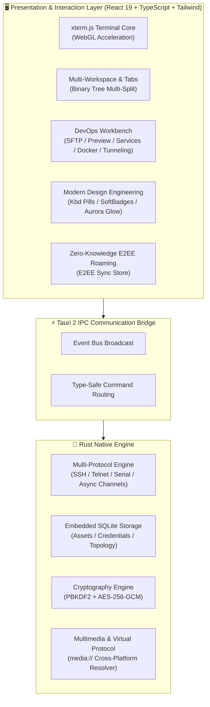

<div align="center">

<p align="center">
  
</p>

# Qshell

### 🚀 Modern High-Performance Desktop Terminal & Multi-Protocol Operations Workbench

<p align="center">
  <a href="./README.md"><b>English</b></a> |
  <a href="./docs/README_zh-CN.md"><b>简体中文</b></a> |
  <a href="./docs/README_zh-TW.md"><b>繁體中文</b></a> |
  <a href="./docs/README_ja.md"><b>日本語</b></a> |
  <a href="./docs/README_ko.md"><b>한국어</b></a>
</p>

[](https://github.com/Tomshushu/Qshell/releases)
[](https://gitee.com/Tom-shushu/qshell/releases)
[](https://tauri.app/)
[](https://react.dev/)
[](https://www.rust-lang.org/)
[](./LICENSE)


**Lightweight & Blazing Fast · Local Markov Command Prediction · Modern Hacker Aesthetics · Zero-Knowledge E2EE Cloud Sync · Full-Stack Protocol Hub · Agentless Monitoring**

[🌐 GitHub Releases](https://github.com/Tomshushu/Qshell/releases) · [⚡ Gitee Fast Mirror (China)](https://gitee.com/Tom-shushu/qshell/releases) · [✨ Highlights](#-why-qshell-highlights) · [📖 Features](#-key-features) · [📦 Download](#-download--installation) · [🤝 Contributing](./CONTRIBUTING.md)

</div>

---

## ✨ Why Qshell? (Highlights)

Qshell is engineered to deliver a **lightweight, agile, secure, and all-in-one** next-generation server management workbench, seamlessly bridging terminal workflows with daily DevOps scenarios:

- ⚡ **Ultra Lightweight · Native Performance**  
  Powered by Tauri 2 + Rust native security core, idling at only **~60MB RAM** with sub-second cold starts. Built on xterm.js with WebGL hardware acceleration, smoothly rendering 100,000+ lines of high-frequency streaming logs without frame drops.

- 🧠 **Local Markov Chain Command Prediction & OSC-7 CWD Context**  
  Driven by a first-order Markov transition probability model combined with terminal OSC-7 protocol: **0ms local inference, 0 Token cost, and 100% offline data confidentiality**. Preloaded with 7 major engineering workflows (Git, Docker, Systemd, etc.) and dynamic slot extraction/propagation (e.g., `mkdir` intelligently suggests `cd <dir>`), adapting in real-time to your keystroke muscle memory.

- 🎨 **Top-Tier Geek Design Engineering (Linear, Raycast & Cursor Standards)**  
  Full-stack visual refactoring: tactile Raycast `<Kbd>` keycap pills, Linear-inspired soft badges with `status-dot-pulse` breathing dots, hairline glassmorphic depth, and anti-jitter tabular figures (`tabular-nums`) across transfer rates and monitoring metrics.

- 📁 **Modern SFTP Directory Refactoring & Instant Document Preview**  
  Dual-pane capsule pill breadcrumb navigation, hairline table without vertical grid noise, dedicated `FolderUp` parent navigation row, and high-concurrency recursive transfer pool. Native in-app preview for Word (`.docx`), Excel (`.xlsx`), PPT (`.pptx`), PDF, code syntax highlighting, and archives without external software.

- 🖥️ **All-in-One Multi-Protocol Asset Hub**  
  Native support for **SSH, Telnet, Industrial Serial (COM), Windows Native RDP, and Out-of-Band BMC Redfish** over HTTPS. Includes multi-hop ProxyJump, SSH tunneling, custom hierarchical grouping, and localized OS support.

- 📊 **Agentless Deep System Perception & Monitoring**  
  No intrusive daemons or agents required on remote hosts. Live CPU, memory breakdown, disk I/O, and network throughput telemetry over standard SSH; integrated **Systemd service manager** (with `journalctl` stream), process tree, and **Docker container lifecycle**.

- 🔐 **Zero-Knowledge E2EE End-to-End Cloud Roaming**  
  Cross-device seamless sync via private GitHub / Gitee repositories. Armed with `PBKDF2-HMAC-SHA256 + AES-256-GCM` military-grade encryption: master passwords and credentials **never leave your device in plaintext**.

- 🛡️ **Unlimited Multi-Pane Tiling & Frictionless Interaction**  
  Recursive binary tree split panes with zero layout limits, independent workspaces, tab locking/coloring, dynamic video wallpapers, and instant selection copy dismiss.

---

## 📖 Introduction

**Qshell** is a modern, high-performance desktop server operations workbench crafted for developers, system administrators, and DevOps engineers.

Built on **Tauri 2 + Rust + React 19**, Qshell integrates multi-protocol terminals (SSH / Telnet / Serial / RDP / BMC Redfish), concurrent SFTP with instant document preview, agentless telemetry, Systemd management, Docker orchestration, SSH tunneling, and zero-knowledge end-to-end encrypted sync into a single cohesive experience.

---

## 🌟 Key Features

### 1. ⚡ Native Performance & Modern Architecture
- **Rust-Powered Engine**: Over **70% memory reduction** compared to Electron-based terminals; sub-second cold starts.
- **WebGL Hardware Accelerated Rendering**: Smoothly handles 100,000+ lines of scrolling terminal output with GPU rendering.
- **Unlimited Multi-Pane Split (Binary Tree)**:
  - Drag and drop tabs to any viewport edge (top/bottom/left/right) for recursive nested tiling without pane count limits;
  - Resizable split proportions with minimum viewport safety constraints.
- **Multi-Workspace & Tab Protection**: Isolated workspaces, session cloning, tab renaming, accidental-close protection (locking), and custom color coding. Terminal instances and history persist seamlessly across layout transitions.

### 2. 🧠 Local Markov Command Intelligence & CWD Context
- **0ms Local Inference · Zero Token Cost**:
  - Operates 100% on-device without cloud LLM round-trip latency or quota limits;
  - Completely offline and confidential—no API keys required, ideal for air-gapped data centers.
- **Built-in Engineering Workflow Priors**:
  - **Git**: `git add .` $\xrightarrow{96\%}$ `git commit -m ""` $\xrightarrow{94\%}$ `git push`; `git pull` $\rightarrow$ `npm/pnpm install`;
  - **Docker**: `docker-compose down` $\xrightarrow{94\%}$ `docker-compose up -d` $\rightarrow$ `docker-compose logs -f`;
  - **Systemd**: `systemctl restart <svc>` $\xrightarrow{96\%}$ `systemctl status <svc>` $\rightarrow$ `journalctl -u <svc> -f`;
  - **Archive & Directories**: `tar -zxvf <pkg>` $\rightarrow$ `cd <extracted_dir>`; `df -h` $\rightarrow$ `du -sh * | sort -hr | head -n 10`.
- **Dynamic Slot Extraction & Propagation**:
  - Intelligently extracts arguments from preceding commands (paths, service names, container IDs, git branches);
  - E.g., executing `mkdir -p /data/app_v2`, typing `c` automatically fills `cd /data/app_v2`. Press <kbd>Tab</kbd> to accept.
- **OSC-7 Driven Real-Time Working Directory (CWD) Awareness**:
  - Hooks into terminal OSC-7 escape sequences to track remote shell working directories in real time;
  - Isolates and weights commands by directory context (e.g., prioritizing log viewing in `/var/log` and build commands in source repos).
- **Online Self-Learning & Recency Decay**:
  - Automatically learns and weights command transitions upon pressing Enter;
  - Adapts to proprietary scripts and habits within 1-2 executions with half-life recency decay.

### 3. 🎨 Modern Design System & Tactile Engineering
- **Tactile Keycap Components (Raycast-Style `<Kbd>`)**: Physical desktop keycap styling with hairline bevels, subtle top specular highlights, and explicit `xs`, `sm`, and `md` size standards.
- **Linear-Grade Soft Badges & Pulse Dots**: Low-saturation soft badges (`soft`, `soft-success`, `soft-warning`, `soft-destructive`, `soft-info`) combined with `status-dot-pulse` live breathing dots for connection, listening, and transfer states.
- **Hairline Glassmorphism & Floating HUDs**: Global command palette (⌘K), terminal search bar, and context menus feature `inset 0 1px 0` top inner glow with layered anti-aliased floating drop shadows.
- **Cursor-Inspired Aurora Glow**: Ambient deep aurora glow in the AI Assistant header and primary panels for an elegant, non-fatiguing visual hierarchy.
- **Tabular Figures Anti-Jitter**: Applied `font-mono tabular-nums` across SFTP transfer rates, process metrics (PID, CPU, MEM, VSZ, RSS), serial baud rates, and search match counters to prevent numeric wobble.

### 4. 📁 Modern SFTP & Out-of-the-Box Document Preview
- **Capsule Pill Breadcrumbs**: Rounded pill hierarchy navigation with `FolderOpen` active indicator and root/drive quick-switching.
- **Hairline Pure Table & Dedicated Parent Row**: Clean horizontal hairlines with zero vertical grid noise. Dedicated `FolderUp` parent row with `<Kbd>Alt+↑</Kbd>` shortcut hint to prevent accidental renaming.
- **High-Concurrency Recursive Transfer Pool**: Optimized worker pool for directory traversal and file uploads/downloads with smoothed throughput metrics.
- **Zero-Dependency Native Document Preview**:
  - 📄 **Office & Docs**: Word (`.docx`), Excel (`.xlsx`), PowerPoint (`.pptx`), PDF, Markdown;
  - 🖼️ **Images**: PNG, JPG, WEBP, GIF, SVG, BMP, HEIC, PSD;
  - 📦 **Archives**: Interactive tree exploration and extraction for Zip, Tar, Gz, 7z, Xz;
  - 📝 **Code & Logs**: Syntax highlighting for major programming languages with in-place lightweight editing.

### 5. 🔐 Zero-Knowledge End-to-End Encrypted Sync (E2EE)
- **Full Configuration Roaming**: Encrypted sync of servers, credentials, hierarchical groups, SSH keys, tags, known host fingerprints, quick commands, and log bookmarks.
- **Multimedia Wallpaper Roaming**: Synchronize custom terminal background images and looping video wallpapers across operating systems using the virtual `media://` protocol.
- **Cryptographic Specifications**:
  - **NIST SP 800-132**: `PBKDF2-HMAC-SHA256` (100,000 iterations + 16-byte cryptographically secure salt);
  - **NIST SP 800-38D**: Authenticated encryption via `AES-256-GCM` with 16-byte integrity tags;
  - **Zero-Knowledge Architecture**: Master passwords and private keys are never transmitted in plaintext.

### 6. 🖥️ Multi-Protocol Asset Management & Authentication
- **Broad Protocol Support**:
  - **Linux / Unix / Arm**: SSH shell, SFTP, custom terminal themes, and localization;
  - **Serial & Hardware (COM)**: Industrial-grade serial terminal (baud rates, parity, data bits, stop bits, flow control, HEX/ASCII, CRC checksums, DTR/RTS signals, auto-reconnect) and Telnet;
  - **Windows Targets**: Native RDP client invocation;
  - **BMC Out-of-Band Management**: Redfish over HTTPS with remote power control and hardware health telemetry.
- **SSH Tunneling (Port Forwarding)**: Local (`-L`), Remote (`-R`), and Dynamic SOCKS5 (`-D`) proxy forwarding.
- **Multi-Factor Authentication**: Passwords, passphrase-protected private keys, SSH agent forwarding, OpenSSH user certificates, and multi-hop ProxyJump.
- **Server Recycle Bin**: Soft deletion with one-click recovery.

### 7. 📊 Agentless System Monitoring & Ops Toolbox
- **Zero-Footprint Telemetry**: Real-time CPU, detailed memory allocation, disk I/O, network bandwidth, and TCP retransmission rates collected over standard SSH channels.
- **Systemd Management**: GUI start/stop/restart/reload for Linux services, boot enablement management, and live streaming `journalctl` logs.
- **Process & Port Inspection**: Real-time process tree resource sorting, PID safety verification, and network listening port visual mapping.
- **Docker Management**: Inspect container states, stream live container logs, and execute start/stop/restart commands.
- **Network Diagnostics**: One-click DNS lookup, Ping latency jitter, TCP port probing, and HTTP status verification.

### 8. 🛡️ Enterprise Security & Privacy Control
- **Application Lock**: Dual-mode protection (passcode or 9-dot pattern lock) with idle auto-lock and sensitive session teardown (<kbd>Ctrl</kbd> + <kbd>Alt</kbd> + <kbd>L</kbd>).
- **Dangerous Command Guard**: Multi-line script and large text paste confirmation dialog to safeguard against hidden reverse shell injections.
- **Host Key Verification**: Strict SSH host key fingerprint management and MITM defense.
- **Frictionless Copy**: Terminal selection copy dismisses immediately without delays or intrusive toast popups.

---

## 🏗️ Architecture



---

## 📦 Download & Installation

Qshell provides official binaries and portable packages across major operating systems:

| Operating System | Architecture | Package Format | Fast Mirror (Gitee) | Global Release (GitHub) |
| :--- | :--- | :--- | :--- | :--- |
| **Windows** | x86_64 / x64 | `.exe` (NSIS Installer) | [⚡ Download exe](https://gitee.com/Tom-shushu/qshell/releases/download/v1.0.17/Qshell_1.0.17_x64-setup.exe) | [🌐 GitHub Releases](https://github.com/Tomshushu/Qshell/releases/tag/v1.0.17) |
| **macOS** | Apple Silicon (M1/M2/M3/M4) | `.dmg` | [⚡ Download aarch64 dmg](https://gitee.com/Tom-shushu/qshell/releases/download/v1.0.17/Qshell_1.0.17_aarch64.dmg) | [🌐 GitHub Releases](https://github.com/Tomshushu/Qshell/releases/tag/v1.0.17) |
| **macOS** | Apple Silicon (Portable) | `.app.tar.gz` | [⚡ Download aarch64 tar.gz](https://gitee.com/Tom-shushu/qshell/releases/download/v1.0.17/Qshell_1.0.17_aarch64.app.tar.gz) | [🌐 GitHub Releases](https://github.com/Tomshushu/Qshell/releases/tag/v1.0.17) |
| **Linux** | x86_64 / amd64 | `.AppImage` (Portable) | [⚡ Download AppImage](https://gitee.com/Tom-shushu/qshell/releases/download/v1.0.17/Qshell_1.0.17_amd64.AppImage) | [🌐 GitHub Releases](https://github.com/Tomshushu/Qshell/releases/tag/v1.0.17) |
| **Linux** | x86_64 / Debian/Ubuntu | `.deb` (Debian Package) | [⚡ Download deb](https://gitee.com/Tom-shushu/qshell/releases/download/v1.0.17/Qshell_1.0.17_amd64.deb) | [🌐 GitHub Releases](https://github.com/Tomshushu/Qshell/releases/tag/v1.0.17) |

> 🔄 **Seamless OTA Updates**: Existing Qshell installations automatically check for updates via dual GitHub/Gitee channels with Minisign verification. Go to **Settings -> Check for Updates** to update with one click.

---

## ⌨️ Productivity Tips & Shortcuts

| Shortcut (Windows/Linux) | Shortcut (macOS) | Action & Description |
| :--- | :--- | :--- |
| <kbd>Ctrl</kbd> + <kbd>K</kbd> | <kbd>Cmd</kbd> + <kbd>K</kbd> | **Global Command Palette** (Search servers, execute actions, switch themes) |
| <kbd>Ctrl</kbd> + <kbd>T</kbd> | <kbd>Cmd</kbd> + <kbd>T</kbd> | **New Terminal Tab** for current server |
| <kbd>Ctrl</kbd> + <kbd>W</kbd> | <kbd>Cmd</kbd> + <kbd>W</kbd> | **Close Active Tab** (Protected with confirmation prompt) |
| <kbd>Ctrl</kbd> + <kbd>Tab</kbd> | <kbd>Ctrl</kbd> + <kbd>Tab</kbd> | Cycle to **Next Tab** |
| <kbd>Ctrl</kbd> + <kbd>Shift</kbd> + <kbd>Tab</kbd> | <kbd>Ctrl</kbd> + <kbd>Shift</kbd> + <kbd>Tab</kbd> | Cycle to **Previous Tab** |
| <kbd>Ctrl</kbd> + <kbd>Alt</kbd> + <kbd>L</kbd> | <kbd>Cmd</kbd> + <kbd>Option</kbd> + <kbd>L</kbd> | **Lock Application** (Lock screen / setup security) |
| <kbd>Ctrl</kbd> + <kbd>F</kbd> | <kbd>Cmd</kbd> + <kbd>F</kbd> | Toggle **Terminal Search Bar** (Tabular figure anti-jitter) |
| <kbd>Alt</kbd> + <kbd>↑</kbd> | <kbd>Option</kbd> + <kbd>↑</kbd> | **SFTP Parent Directory** navigation (`FolderUp`) |
| <kbd>Esc</kbd> | <kbd>Esc</kbd> | Close search bar / dialog, restoring focus to active terminal |
| <kbd>Ctrl</kbd> + <kbd>L</kbd> | <kbd>Cmd</kbd> + <kbd>L</kbd> | Clear terminal buffer and reset viewport |
| **Drag Tab to Pane Edge** | **Drag Tab to Pane Edge** | **Unlimited Multi-Pane Split**: Drag to top/bottom/left/right highlights |
| **Tab Context Menu** | **Tab Context Menu** | Session clone, rename, lock protection, and color classification |

---

## 🛠️ Local Development

### 1. Prerequisites
- **Node.js**: `>= 18.0.0`
- **Rust Toolchain**: `rustc >= 1.80` and `cargo` ([rustup.rs](https://rustup.rs/))
- **Build Tools**:
  - Windows: Visual Studio C++ Build Tools & WebView2
  - macOS: Xcode Command Line Tools (`xcode-select --install`)
  - Linux: `libwebkit2gtk-4.1-dev build-essential curl wget libssl-dev libudev-dev`

### 2. Setup & Launch
```bash
# 1. Clone repository
git clone https://github.com/Tomshushu/Qshell.git
# Or China mirror: git clone https://gitee.com/Tom-shushu/qshell.git
cd qshell

# 2. Install dependencies
npm install

# 3. Start development environment
npm run dev:tauri
```

### 3. Quality Verification Gate
```bash
# Rust core check
cargo check --manifest-path src-tauri/Cargo.toml

# TypeScript static type check
npx tsc --noEmit

# Undefined reference check
npm run check:undefined

# Full unit and integration tests
npx vitest run

# Production build preview
npm run build
```

---

## 🤝 Contributing

We welcome contributions and feedback from the community!
- **Issues**: Report bugs or submit feature requests using our [Issue Templates](https://github.com/Tomshushu/Qshell/issues/new/choose).
- **Pull Requests**: Please review [**CONTRIBUTING.md**](./CONTRIBUTING.md) before submitting.
- **Release Protocol**: Strict compliance with [**AGENTS.md**](./AGENTS.md) is enforced for release engineering.

---

## 📄 License

Licensed under [Apache License 2.0](./LICENSE). Free for commercial and non-commercial use with patent protection. Copyright © Qshell Community.
