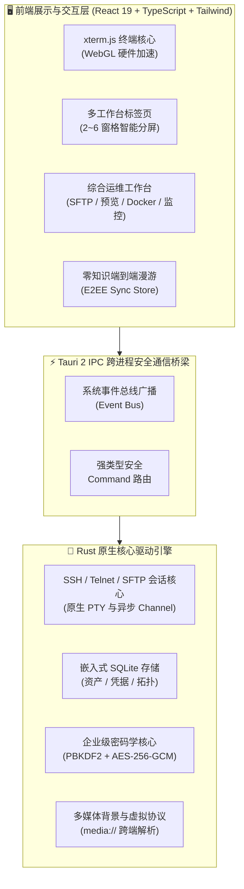

<div align="center">

<p align="center">
  
</p>

# Qshell

### 🚀 现代化极速桌面终端与多协议服务器管理工作台

[](https://github.com/Tomshushu/Qshell/releases)
[](https://gitee.com/Tom-shushu/qshell/releases)
[](https://tauri.app/)
[](https://react.dev/)
[](https://www.rust-lang.org/)
[](./LICENSE)


**轻量极速 · 零知识云漫游 · 全协议支持 · 多维运维集成 · 免 Agent 监控 · 企业级密码学保障**

[⚡ Gitee 国内极速下载](https://gitee.com/Tom-shushu/qshell/releases) · [🌐 GitHub Releases](https://github.com/Tomshushu/Qshell/releases) · [📖 核心特性](#-核心特性与亮点-key-features) · [💡 为何选择 Qshell](#-为何选择-qshell-why-qshell) · [📦 安装指南](#-安装与下载-download--installation) · [🤝 参与贡献](./CONTRIBUTING.md)

</div>

---

## 💡 为何选择 Qshell? (Why Qshell?)

在日常服务器运维中，你是否常常在**笨重的 Electron 终端**（高内存、易卡顿）与**陈旧过时的传统终端**（界面陈旧、云漫游弱、功能单一）之间纠结？

Qshell 正是为此而生：以 **Rust + WebGL 原生性能**为底座，兼具现代化高颜值交互与全能运维能力。

| 特性维度 | Qshell | 传统 Electron 终端 (Tabby 等) | 传统商业终端 (Xshell / SecureCRT) |
| :--- | :--- | :--- | :--- |
| **底层架构** | **Tauri 2 + Rust + WebGL** | Electron + Node.js (重型 Chromium) | C++ / MFC 传统图形库 |
| **内存开销** | **极低 (~60MB)**，冷启动秒开 | 较高 (300MB ~ 800MB)，启动较慢 | 较低 (~50MB) |
| **多协议支持** | **SSH / Telnet / RDP / BMC Redfish** | 多数仅 SSH | 支持主流协议 |
| **文件管理** | **内置 SFTP + Office/PDF/代码多格式秒开预览** | 基础 SFTP 列表，仅简易文本 | 需调用外部第三方本地软件 |
| **系统监控** | **免 Agent 纯管道探测** (CPU/内存/磁盘/网络/端口) | 需另开命令查看或无监控 | 无集成监控面板 |
| **容器运维** | **内置 Docker 管理器** (容器启停/流式日志) | 无 | 无 |
| **云端漫游** | **零知识端到端加密漫游** (Gitee / GitHub 仓库) | 需官方中心化账号或无漫游 | 需手动导出文件导入 |
| **多媒体定制** | **支持自定义背景壁纸与动态视频** (跨端同步) | 部分仅支持本地静态图 | 界面风格相对固定单一 |
| **授权与收费** | **Apache 2.0 完全免费开源** | 社区版功能受限或收费 | 昂贵商业授权 / 个人版受限 |

---

## 📖 项目简介 (Introduction)

**Qshell** 是一款面向开发者、系统管理员与 DevOps 工程师精心打造的**现代化极速桌面服务器运维与多协议工作台**。

项目摒弃了传统 Electron 应用高内存开销与卡顿的弊端，基于 **Tauri 2 + Rust + React 19** 构建，以原生硬件性能驱动终端交互。Qshell 将主机资产树、多协议终端（SSH / Telnet / RDP / BMC Redfish）、带断点续传的 SFTP 文件管理、零侵入系统指标监控、Docker 容器编排、全格式文档实时预览与**端到端零知识加密（E2EE）全量配置漫游**深度融合于同一个优雅直观的工作台中。

---

## 🌟 核心特性与亮点 (Key Features)

### 1. ⚡ 极致性能与现代桌面架构
- **Rust 驱动的原生内核**：内存占用较传统 Electron 终端降低 **70%+**，冷启动秒开，极致轻巧。
- **WebGL 硬件加速渲染**：基于 xterm.js 与 GPU 渲染引擎，支撑 100,000+ 行高频滚动日志，杜绝主线程卡顿与掉帧。
- **持久化会话保护**：支持多工作台标签不设上限切换、2～6 窗格多路分屏、会话广播与跨窗口拖拽，布局切换时终端实例与输入历史永不丢失。

### 2. 🔐 零知识全量端到端云漫游 (Zero-Knowledge E2EE Sync)
- **多维度资产无感漫游**：完整同步服务器配置与凭据、树状分组拓扑、SSH 密钥对库、分类标签、已知主机信任指纹 (`Known Hosts`)、常用命令收藏库 (`Quick Commands`) 以及日志关键词书签。
- **多媒体背景与个性化习惯漫游**：首次支持终端自定义背景壁纸与动态视频同步，通过虚拟协议 `media://` 抹平跨操作系统路径差异；本地 UI 风格、终端字体字号、主题配色、快捷连接历史与命令执行历史换机一键无缝还原。
- **企业级密码学保障**：
  - **NIST SP 800-132**：采用 `PBKDF2-HMAC-SHA256`（100,000 次高强度迭代 + 16 字节高熵随机 Salt）派生密钥；
  - **NIST SP 800-38D**：`AES-256-GCM` 全包认证加密与 16 字节完整性标签防篡改；
  - **零知识原则**：主密码与明文凭据永不上云，第三方托管（GitHub / Gitee 私有仓库）仅持有高强度密文信封；本地全量端到端加密同步资产与配置，支持 Token 与主密码一键安全复制。

### 3. 🖥️ 全协议资产管理与灵活认证
- **全协议栈覆盖**：
  - **Linux / Unix**：SSH 终端、SFTP 双向管理与系统全量深度运维；
  - **网络设备 (Switch/Router)**：支持 SSH 与交互式 Telnet 会话；
  - **Windows 目标**：便捷调用系统原生 RDP 客户端；
  - **服务器带外管理 (BMC)**：Redfish over HTTPS 协议，硬件状态与电源远程控制。
- **多层次安全认证**：支持密码、加密私钥（Passphrase）、SSH Agent 身份枚举、OpenSSH 用户证书认证以及跳板机链式代理（ProxyJump）。

### 4. 📁 现代化 SFTP 与全格式开箱即用原生预览
- **高性能双向传输**：支持文件夹拖拽上传、多任务并发传输、断点续传、文件权限属性调整与后台传输任务管理。
- **开箱即用多格式原生预览**：无须依赖第三方外部软件，直接在应用内快速预览：
  - 📄 **文档文件**：Word (`.docx`)、Excel (`.xlsx`)、PowerPoint (`.pptx`)、PDF、Markdown；
  - 🖼️ **图片与矢量图**：PNG, JPG, WEBP, GIF, SVG, BMP, HEIC, PSD 等；
  - 📦 **主流压缩包**：Zip, Tar, Gz, 7z, Xz 归档目录树交互式展开与快速解压；
  - 📝 **代码与日志**：支持多种主流编程语言语法高亮与轻量级在线快速编辑保存。

### 5. 📊 免 Agent 深度系统感知与运维工具箱
- **无侵入式监控**：远端无需部署任何额外守护进程或 Agent，基于安全 SSH 管道实时采集 CPU、内存、磁盘 IO、网络吞吐。
- **进程与端口拓扑**：实时监测远端进程资源占用、结束进程；可视化探测本地与远端监听端口和网络连接分布。
- **Docker 容器生命周期管理**：查看容器列表、实时状态、流式日志输出、启动/停止/重启容器，免去手工键入繁琐指令。

### 6. 🛡️ 企业级安全堡垒与隐私控制
- **全能应用锁 (Application Lock)**：支持密码锁与九点图案锁双模式，空闲自动加锁，断开敏感会话保障机密安全。
- **危险操作防御**：多行代码与大文本粘贴二次安全确认，有效防范黑客反弹 Shell 等隐蔽脚本攻击。
- **主机指纹防伪校验**：严格验证 SSH Host Key，支持一键重置与信任指纹管理，阻断中间人攻击 (MITM)。

---

## 🏗️ 架构概览 (Architecture)



---

## 📦 安装与下载 (Download & Installation)

Qshell 为各大主流操作系统提供了开箱即用的安装包与绿色便携版：

| 操作系统 | 架构 | 安装包格式 | 国内极速直链 (Gitee) | 全球发布源 (GitHub) |
| :--- | :--- | :--- | :--- | :--- |
| **Windows** | x86_64 / x64 | `.exe` (NSIS 安装包) | [⚡ 下载 exe 安装包](https://gitee.com/Tom-shushu/qshell/releases/download/v1.0.11/Qshell_1.0.11_x64-setup.exe) | [🌐 GitHub Releases](https://github.com/Tomshushu/Qshell/releases/tag/v1.0.11) |
| **macOS** | Apple Silicon (M1/M2/M3/M4) | `.dmg` | [⚡ 下载 aarch64 dmg](https://gitee.com/Tom-shushu/qshell/releases/download/v1.0.11/Qshell_1.0.11_aarch64.dmg) | [🌐 GitHub Releases](https://github.com/Tomshushu/Qshell/releases/tag/v1.0.11) |
| **macOS** | Apple Silicon (便携包) | `.app.tar.gz` | [⚡ 下载 aarch64 压缩包](https://gitee.com/Tom-shushu/qshell/releases/download/v1.0.11/Qshell_1.0.11_aarch64.app.tar.gz) | [🌐 GitHub Releases](https://github.com/Tomshushu/Qshell/releases/tag/v1.0.11) |
| **Linux** | x86_64 / amd64 | `.AppImage` (免安装便携版) | [⚡ 下载 AppImage](https://gitee.com/Tom-shushu/qshell/releases/download/v1.0.11/Qshell_1.0.11_amd64.AppImage) | [🌐 GitHub Releases](https://github.com/Tomshushu/Qshell/releases/tag/v1.0.11) |
| **Linux** | x86_64 / Debian/Ubuntu | `.deb` (系统安装包) | [⚡ 下载 deb 包](https://gitee.com/Tom-shushu/qshell/releases/download/v1.0.11/Qshell_1.0.11_amd64.deb) | [🌐 GitHub Releases](https://github.com/Tomshushu/Qshell/releases/tag/v1.0.11) |

> 💡 **国内用户建议优先前往 [Gitee Releases 发行页](https://gitee.com/Tom-shushu/qshell/releases)** 享受无障碍高速下载。
> 
> 🔄 **全自动无感 OTA 在线升级**：已安装 Qshell 的用户无须手动重新下载，客户端内置 GitHub 与 Gitee 双通道智能测速与 Minisign 验签更新引擎。在【设置】->【检查更新】中即可一键完成安全差量升级。

---

## ⌨️ 常用快捷键与操作技巧 (Productivity Tips)

| 快捷键 (Windows/Linux) | 快捷键 (macOS) | 功能说明 |
| :--- | :--- | :--- |
| <kbd>Ctrl</kbd> + <kbd>T</kbd> | <kbd>Cmd</kbd> + <kbd>T</kbd> | 快速新建空白终端标签页 |
| <kbd>Ctrl</kbd> + <kbd>W</kbd> | <kbd>Cmd</kbd> + <kbd>W</kbd> | 关闭当前活跃终端会话 |
| <kbd>Ctrl</kbd> + <kbd>Shift</kbd> + <kbd>D</kbd> | <kbd>Cmd</kbd> + <kbd>Shift</kbd> + <kbd>D</kbd> | 左右横向分屏终端窗格 |
| <kbd>Ctrl</kbd> + <kbd>Shift</kbd> + <kbd>E</kbd> | <kbd>Cmd</kbd> + <kbd>Shift</kbd> + <kbd>E</kbd> | 上下纵向分屏终端窗格 |
| <kbd>Ctrl</kbd> + <kbd>F</kbd> | <kbd>Cmd</kbd> + <kbd>F</kbd> | 呼出终端高亮检索框 |
| <kbd>Ctrl</kbd> + <kbd>Shift</kbd> + <kbd>F</kbd> | <kbd>Cmd</kbd> + <kbd>Shift</kbd> + <kbd>F</kbd> | 快速打开当前主机的 SFTP 目录 |
| <kbd>Ctrl</kbd> + <kbd>L</kbd> | <kbd>Cmd</kbd> + <kbd>L</kbd> | 清屏当前会话并重置视口 |

---

## 🛠️ 本地开发与构建 (Local Development)

如果你希望在本地运行或参与功能开发，请遵循以下步骤：

### 1. 前置依赖准备
- **Node.js**：`>= 18.0.0`
- **Rust 工具链**：`rustc >= 1.80` 与 `cargo`（[rustup.rs](https://rustup.rs/)）
- **C++ 编译环境**：
  - Windows: Visual Studio C++ Build Tools & WebView2
  - macOS: Xcode Command Line Tools (`xcode-select --install`)
  - Linux: `libwebkit2gtk-4.1-dev build-essential curl wget libssl-dev libudev-dev`

### 2. 获取代码与启动
```bash
# 1. 克隆代码仓库 (国内可使用 Gitee 镜像)
git clone https://gitee.com/Tom-shushu/qshell.git
# 或全球源: git clone https://github.com/Tomshushu/Qshell.git
cd qshell

# 2. 安装前端依赖
npm install

# 3. 启动桌面端热重载开发模式
npm run dev:tauri
```

### 3. 代码质量门禁验证
```bash
# 执行 Rust 编译检查
cargo check --manifest-path src-tauri/Cargo.toml

# 执行 TypeScript 静态类型检查
npx tsc --noEmit

# 执行未定义标识符拦截检查
npm run check:undefined

# 运行全量单元测试与集成测试
npx vitest run

# 执行生产环境打包预演
npm run build
```

---

## 🤝 参与贡献 (Contributing)

我们非常欢迎社区开发者为 Qshell 贡献代码或提出想法！

- **提交 Issue**：报告 Bug 或提出新需求，请直接使用我们的 [Issue 模板](https://github.com/Tomshushu/Qshell/issues/new/choose)。
- **提交 PR**：在发起代码合并请求前，请详细阅读 [**开源贡献指南 (CONTRIBUTING.md)**](./CONTRIBUTING.md)。
- **发版标准**：核心维护者发版请严格遵守 [**发版标准作业程序 (RELEASE_GUIDE.md)**](./RELEASE_GUIDE.md)。

---

## 📄 开源许可证 (License)

本项目采用 [Apache License 2.0](./LICENSE) 协议开源。你可以自由商用、修改与分发，同时享有专利保障，版权归 Qshell 社区所有。
