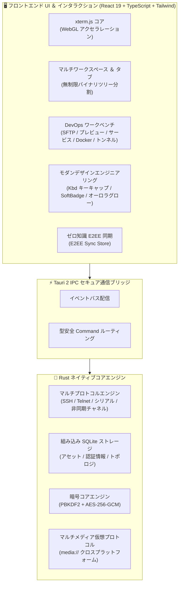

<div align="center">

<p align="center">
  
</p>

# Qshell

### 🚀 近代的で極めて高速なデスクトップ端末 ＆ マルチプロトコル運用管理ワークベンチ

<p align="center">
  <a href="./README.md"><b>简体中文</b></a> |
  <a href="./README_en.md"><b>English</b></a> |
  <a href="./README_zh-TW.md"><b>繁體中文</b></a> |
  <a href="./README_ja.md"><b>日本語</b></a> |
  <a href="./README_ko.md"><b>한국어</b></a>
</p>

[](https://github.com/Tomshushu/Qshell/releases)
[](https://gitee.com/Tom-shushu/qshell/releases)
[](https://tauri.app/)
[](https://react.dev/)
[](https://www.rust-lang.org/)
[](./LICENSE)


**軽量高速 · ローカルマルコフ予測 · 洗練されたギーク美学 · ゼロ知識クラウド同期 · 全プロトコル対応 · エージェントレス監視**

[🌐 GitHub Releases](https://github.com/Tomshushu/Qshell/releases) · [⚡ Gitee 高速ミラー (中国)](https://gitee.com/Tom-shushu/qshell/releases) · [✨ 主な特徴](#-qshell-が選ばれる理由-highlights) · [📖 機能一覧](#-コア機能とハイライト-key-features) · [📦 インストール](#-ダウンロードとインストール-download--installation) · [🤝 コントリビューション](./CONTRIBUTING.md)

</div>

---

## ✨ Qshell が選ばれる理由 (Highlights)

Qshell は、**軽量・俊敏・高セキュリティ・オールインワン**を追求した次世代サーバー管理ワークベンチであり、ターミナル操作と日常の運用管理をシームレスに統合します：

- ⚡ **圧倒的な軽量性とネイティブパフォーマンス**  
  Tauri 2 + Rust ネイティブセキュリティコアを搭載し、アイドル時メモリ消費量はわずか **約 60MB**、コールドスタートもミリ秒級の超高速起動を実現。xterm.js と WebGL ハードウェアアクセラレーションにより、100,000 行以上のストリーミングログでもコマ落ちなく滑らかに描画します。

- 🧠 **ローカルマルコフ連鎖コマンド予測 ＆ OSC-7 ディレクトリ検知**  
  一次マルコフ遷移確率モデルとターミナル OSC-7 プロトコルに基づき、**0ms ローカル推論・Token 消費ゼロ・100% オフライン機密保持** を実現。Git、Docker、Systemd など 7 大エンジニアリングワークフローと動的引数スロット自動抽出（例：`mkdir` からの `cd <dir>` 推測）を内蔵し、タイピング習慣に応じた継続学習により、<kbd>Tab</kbd> キーで瞬時に採用可能です。

- 🎨 **最高峰デザイン基準（Linear、Raycast、Cursor UI 標準）**  
  UI 全体を最新のデスクトップ水準へ再構築：Raycast 風の触覚フィードバックを備えた `<Kbd>` 実体キーキャップ、Linear 仕様の微細ソフトバッジ（Soft Badges）と `status-dot-pulse` 呼吸インジケータ、ヘアラインガラスモーフィズム、転送レートやプロセス指標でのブレを防ぐ等幅数字（`tabular-nums`）を完備。

- 📁 **モダン SFTP ディレクトリ再構築 ＆ ネイティブドキュメントプレビュー**  
  カプセル型ピル階層パンくずリスト、垂直グリッド線を排除した純粋ヘアラインテーブル、専用の `FolderUp` 上位ディレクトリ誘導行、高並行再帰転送プールを搭載。Word (`.docx`)、Excel (`.xlsx`)、PPT (`.pptx`)、PDF、コードシンタックス強調表示、各種アーカイブを外部アプリ不要で直接プレビュー可能。

- 🖥️ **ワンストップ・マルチプロトコルアセットハブ**  
  **SSH、Telnet、産業用シリアル (COM)、Windows ネイティブ RDP、アウトオブバンド BMC Redfish** プロトコルを標準装備。多段 ProxyJump、SSH トンネルポートフォワーディング、柔軟なツリー構造グループ化に対応します。

- 📊 **エージェント不要のディープシステム監視と運用**  
  リモートサーバーへ専用常駐エージェントをインストールする必要は一切ありません。安全な SSH パイプライン経由で、CPU・詳細メモリ・ディスク I/O・ネットワーク帯域をリアルタイム監視。**Systemd サービス管理**（`journalctl` ストリーミング含む）、プロセストポロジ、**Docker コンテナ管理** を直感的に操作できます。

- 🔐 **ゼロ知識 E2EE エンドツーエンド暗号化クラウド同期**  
  GitHub / Gitee プライベートリポジトリを介してクロスデバイス同期を実現。`PBKDF2-HMAC-SHA256 + AES-256-GCM` 軍用規格の暗号化を採用し、マスターパスワードや認証情報は**平文でクラウドに送信されることはありません**。

- 🛡️ **無制限の自由分割スクリーンと快適な操作性**  
  バイナリツリー型無制限マルチペイン分割、独立ワークスペース、タブ保護・カラータグ、動的動画壁紙の同期、ターミナル選択範囲の瞬時コピー（待ち時間なし）など、高い生産性と美しいデザインを両立。

---

## 📖 プロジェクト紹介 (Introduction)

**Qshell** は、開発者、システム管理者、DevOps エンジニアのために丹念に設計された**近代的で極めて高速なデスクトップサーバー運用管理ワークベンチ**です。

**Tauri 2 + Rust + React 19** を基盤とし、ネイティブハードウェアの性能を最大限に引き出します。ホストアセット管理、マルチプロトコル端末、並行断続転送対応 SFTP、エージェントレス監視、Systemd 管理、Docker 編成、SSH トンネル、多様なドキュメントの即時プレビュー、そして**ゼロ知識エンドツーエンド暗号化同期**が 1 つの洗練されたデスクトップ環境に統合されています。

---

## 🌟 コア機能とハイライト (Key Features)

### 1. ⚡ ネイティブパフォーマンスと最新アーキテクチャ
- **Rust 駆動のネイティブコア**：Electron ベースの端末と比較してメモリ消費量を **70% 以上削減**、瞬時のコールドスタート。
- **WebGL ハードウェアアクセラレーション**：GPU レンダリングにより、100,000 行以上のログスクロールも負荷なく軽快に描画。
- **無制限マルチペイン分割（バイナリツリー構造）**：
  - タブをペインの上下左右の端にドラッグ＆ドロップすることで、ペイン数の上限なく自由自在に再帰分割可能；
  - 最小表示域を保護しながら、マウスドラッグで縦横比率をリアルタイムに調整。
- **マルチワークスペースとタブ保護**：独立したワークスペースの切り替え、セッション複製、タブ名称変更、誤操作防止ロック、カスタムカラーバッジに対応。

### 2. 🧠 ローカルマルコフ連鎖コマンドインテリジェンス ＆ OSC-7 コンテキスト
- **0ms 高速ローカル推論 · Token コストゼロ**：
  - クラウド LLM のレイテンシやクォータ制限を完全排除し、**100% クライアント端末側で実行**；
  - オフライン環境や機密性の高い閉域網・データセンターでも安全に利用可能。
- **エンジニアリング向けゴールデンフロー内蔵**：
  - **Git 連携**：`git add .` $\xrightarrow{96\%}$ `git commit -m ""` $\xrightarrow{94\%}$ `git push`；`git pull` $\rightarrow$ `npm/pnpm install`；
  - **Docker**：`docker-compose down` $\xrightarrow{94\%}$ `docker-compose up -d` $\rightarrow$ `docker-compose logs -f`；
  - **Systemd**：`systemctl restart <svc>` $\xrightarrow{96\%}$ `systemctl status <svc>` $\rightarrow$ `journalctl -u <svc> -f`；
  - **展開・ディレクトリ移動**：`tar -zxvf <pkg>` $\rightarrow$ `cd <解凍先>`；`df -h` $\rightarrow$ `du -sh * | sort -hr | head -n 10`。
- **動的パラメータスロット抽出と自動補完**：
  - 先行コマンドからパス、サービス名、コンテナ名、ブランチ名を賢く捕捉；
  - 例：`mkdir -p /data/app_v2` の直後に `c` を入力すると、自動的に `cd /data/app_v2` が提示され、<kbd>Tab</kbd> で確定。
- **OSC-7 プロトコルによるリアルタイム作業ディレクトリ（CWD）検知**：
  - ターミナルの OSC-7 シーケンスをリアルタイムに解析し、リモートシェルのカレントディレクトリを把握；
  - `/var/log` 下ではログ監視コマンドを、ソースリポジトリ下ではビルドや Git コマンドを優先重み付け。
- **オンライン強化学習と減衰モデル**：
  - コマンド実行のたびにローカルで自動学習し、利用者の指先のクセに寄り添った予測へと進化します。

### 3. 🎨 モダンデザインシステム ＆ 触覚エンジニアリング
- **触覚キーキャップコンポーネント（`<Kbd>`）**：ベベルと天面ハイライトを備えた Raycast 風の物理キーキャップ。明示的な `xs`、`sm`、`md` サイズ規約を確立。
- **Linear 仕様ソフトバッジと呼吸ドット**：低彩度のソフトバッジ（`soft-success`、`soft-warning` 等）と `status-dot-pulse` 呼吸インジケータにより、接続・リッスン・転送状態を上品に可視化。
- **ヘアラインガラスモーフィズムと浮遊 HUD**：コマンドパレット（⌘K）、検索バー、右クリックメニューに `inset 0 1px 0` の極細インナーシャドウと多層アンチエイリアスドロップシャドウを採用。
- **Cursor 風オーロラグロー**：AI アシスタントヘッダーに深遠なオーロラグローを配置し、視覚的疲労のない美麗な UI を実現。
- **等幅数値（Tabular Figures）の防振**：SFTP 転送速度、プロセス指標、シリアル通信レート、検索一致件数に `font-mono tabular-nums` を適用し、数値変動によるチラつきを徹底排除。

### 4. 📁 モダン SFTP と標準ネイティブプレビュー
- **カプセル型ピルパンくずリスト**：アクティブ末端ディレクトリに `FolderOpen` アイコンを表示し、ルート・ドライブ切り替えもワンクリック。
- **垂直線のないピュアヘアラインテーブル**：Excel 風の縦罫線を排除し、専用 `FolderUp` 上位ディレクトリ行と `<Kbd>Alt+↑</Kbd>` ショートカットヒントを配置。
- **高並行再帰転送プール**：フォルダの再帰走査とマルチタスク転送を最適化し、スループットを滑らかに計測。
- **ゼロ依存ネイティブファイルプレビュー**：
  - 📄 **文書**：Word (`.docx`)、Excel (`.xlsx`)、PowerPoint (`.pptx`)、PDF、Markdown；
  - 🖼️ **画像**：PNG, JPG, WEBP, GIF, SVG, BMP, HEIC, PSD など；
  - 📦 **アーカイブ**：Zip, Tar, Gz, 7z, Xz の構造ツリー閲覧と展開；
  - 📝 **コード・ログ**：主要言語の構文ハイライトと簡易インプレース編集。

### 5. 🔐 ゼロ知識 E2EE クラウド同期
- **全設定ローミング**：サーバー資産、資格情報、グループ、SSH 鍵、タグ、Known Hosts 指紋、クイックコマンド、ログブックマークを完全暗号化同期。
- **動的壁紙同期**：仮想プロトコル `media://` を通じて、カスタム背景画像やループ動画壁紙を OS の垣根を超えて同期。
- **暗号学仕様**：
  - **NIST SP 800-132**：`PBKDF2-HMAC-SHA256`（100,000 回反復ストレッチ ＋ 16 バイト高エントロピーソルト）；
  - **NIST SP 800-38D**：`AES-256-GCM` 認証付き暗号 ＋ 16 バイト改ざん検証タグ；
  - **ゼロ知識設計**：マスターパスワードおよび平文クレデンシャルが外部へ漏洩することは構造上あり得ません。

### 6. 🖥️ マルチプロトコルアセット管理と認証
- **幅広いプロトコル対応**：
  - **Linux / Unix**：SSH 端末、SFTP、独自テーマ対応；
  - **シリアル・COM ポート**：産業グレードのシリアルデバッグ端末（ボーレート、データビット、パリティ、フロー制御、HEX/ASCII、CRC、DTR/RTS 信号監視）および Telnet；
  - **Windows**：システムネイティブ RDP クライアントのワンタッチ起動；
  - **BMC リモート管理**：Redfish over HTTPS によるハードウェア状態監視と電源オン・オフ・リブート。
- **SSH トンネル（ポート転送）**：ローカル転送 (`-L`)、リモート転送 (`-R`)、動的 SOCKS5 (`-D`)。
- **強固な認証**：パスワード、パスフレーズ付き秘密鍵、SSH エージェント、OpenSSH 証明書、多段 ProxyJump。
- **サーバーごみ箱機能**：誤削除防止の論理削除とワンクリック復元。

### 7. 📊 エージェントレス監視と DevOps ツールボックス
- **侵入ゼロの監視**：標準 SSH 接続のみを用いて CPU、詳細メモリ、ディスク I/O、ネットワークスループットを計測。
- **Systemd 管理**：Linux サービスの起動・停止・再起動・リロード、自動起動設定、`journalctl` ストリーミングログの確認。
- **プロセスとポート監視**：プロセスツリーのリソース監視、PID 衝突防止検証、リッスンポートの可視化。
- **Docker ライフサイクル**：コンテナ一覧、稼働状態、リアルタイムログ、起動・停止操作。
- **ネットワーク総合診断**：DNS 名前解決、Ping レイテンシ測定、TCP ポート導通、HTTP ステータス検査。

### 8. 🛡️ エンタープライズセキュリティとプライバシー
- **アプリケーションロック**：パスワードロックおよび 9 箇所のパターンロック、アイドル自動ロック（<kbd>Ctrl</kbd> + <kbd>Alt</kbd> + <kbd>L</kbd>）。
- **危険コマンド防御**：複数行スクリプトや大容量テキストの貼り付け確認ダイアログ。
- **ホスト鍵検証**：厳密な SSH ホスト鍵検証と中間者攻撃（MITM）遮断。
- **ノイズのないコピー操作**：選択領域のコピー実行時に余計なポップアップを残さず瞬時に閉じます。

---

## 🏗️ アーキテクチャ



---

## 📦 ダウンロードとインストール (Download & Installation)

各 OS 向けの公式インストーラおよびポータブル版を提供しています：

| OS | アーキテクチャ | 形式 | 高速ミラー (Gitee) | グローバル (GitHub) |
| :--- | :--- | :--- | :--- | :--- |
| **Windows** | x86_64 / x64 | `.exe` (NSIS) | [⚡ exe インストーラ](https://gitee.com/Tom-shushu/qshell/releases/download/v1.0.17/Qshell_1.0.17_x64-setup.exe) | [🌐 GitHub Releases](https://github.com/Tomshushu/Qshell/releases/tag/v1.0.17) |
| **macOS** | Apple Silicon (M1/M2/M3/M4) | `.dmg` | [⚡ aarch64 dmg](https://gitee.com/Tom-shushu/qshell/releases/download/v1.0.17/Qshell_1.0.17_aarch64.dmg) | [🌐 GitHub Releases](https://github.com/Tomshushu/Qshell/releases/tag/v1.0.17) |
| **macOS** | Apple Silicon (ポータブル) | `.app.tar.gz` | [⚡ aarch64 tar.gz](https://gitee.com/Tom-shushu/qshell/releases/download/v1.0.17/Qshell_1.0.17_aarch64.app.tar.gz) | [🌐 GitHub Releases](https://github.com/Tomshushu/Qshell/releases/tag/v1.0.17) |
| **Linux** | x86_64 / amd64 | `.AppImage` (ポータブル) | [⚡ AppImage](https://gitee.com/Tom-shushu/qshell/releases/download/v1.0.17/Qshell_1.0.17_amd64.AppImage) | [🌐 GitHub Releases](https://github.com/Tomshushu/Qshell/releases/tag/v1.0.17) |
| **Linux** | x86_64 / Debian/Ubuntu | `.deb` (deb パッケージ) | [⚡ deb パッケージ](https://gitee.com/Tom-shushu/qshell/releases/download/v1.0.17/Qshell_1.0.17_amd64.deb) | [🌐 GitHub Releases](https://github.com/Tomshushu/Qshell/releases/tag/v1.0.17) |

> 🔄 **全自動 OTA アップデート**：既存のインストール環境からは、【設定】->【アップデートを確認】により、GitHub / Gitee の最適ルートから差分アップデートをワンクリックで実行できます。

---

## ⌨️ 主なショートカット一覧 (Productivity Tips)

| ショートカット (Windows/Linux) | ショートカット (macOS) | 機能説明 |
| :--- | :--- | :--- |
| <kbd>Ctrl</kbd> + <kbd>K</kbd> | <kbd>Cmd</kbd> + <kbd>K</kbd> | **グローバルコマンドパレット**（サーバー検索、操作実行、テーマ切替） |
| <kbd>Ctrl</kbd> + <kbd>T</kbd> | <kbd>Cmd</kbd> + <kbd>T</kbd> | 現在のアクティブサーバーで**新規ターミナルタブを開く** |
| <kbd>Ctrl</kbd> + <kbd>W</kbd> | <kbd>Cmd</kbd> + <kbd>W</kbd> | **アクティブタブを閉じる**（確認プロンプトによる誤操作防止対応） |
| <kbd>Ctrl</kbd> + <kbd>Tab</kbd> | <kbd>Ctrl</kbd> + <kbd>Tab</kbd> | **次のタブ** へ切り替え |
| <kbd>Ctrl</kbd> + <kbd>Shift</kbd> + <kbd>Tab</kbd> | <kbd>Ctrl</kbd> + <kbd>Shift</kbd> + <kbd>Tab</kbd> | **前のタブ** へ切り替え |
| <kbd>Ctrl</kbd> + <kbd>Alt</kbd> + <kbd>L</kbd> | <kbd>Cmd</kbd> + <kbd>Option</kbd> + <kbd>L</kbd> | **アプリをロック**（ロック画面の起動・初期設定） |
| <kbd>Ctrl</kbd> + <kbd>F</kbd> | <kbd>Cmd</kbd> + <kbd>F</kbd> | **ターミナル内検索バー** の表示（等幅数値防振仕様） |
| <kbd>Alt</kbd> + <kbd>↑</kbd> | <kbd>Option</kbd> + <kbd>↑</kbd> | **SFTP 上位ディレクトリへの移動**（専用 `FolderUp` 行） |
| <kbd>Esc</kbd> | <kbd>Esc</kbd> | 検索バー・パレット・ダイアログを閉じ、フォーカスをターミナルへ戻す |
| <kbd>Ctrl</kbd> + <kbd>L</kbd> | <kbd>Cmd</kbd> + <kbd>L</kbd> | ターミナル画面のクリア |
| **タブをペイン端へドラッグ** | **タブをペイン端へドラッグ** | **無制限マルチペイン分割**：上下左右のハイライトへ配置 |
| **タブ右クリックメニュー** | **タブ右クリックメニュー** | セッション複製、名称変更、ロック保護、カラータグ分類 |

---

## 🛠️ ローカル開発とビルド (Local Development)

### 1. 前提条件
- **Node.js**：`>= 18.0.0`
- **Rust ツールチェーン**：`rustc >= 1.80` および `cargo`（[rustup.rs](https://rustup.rs/)）
- **C++ ビルドツール**：
  - Windows: Visual Studio C++ Build Tools & WebView2
  - macOS: Xcode Command Line Tools (`xcode-select --install`)
  - Linux: `libwebkit2gtk-4.1-dev build-essential curl wget libssl-dev libudev-dev`

### 2. セットアップと起動
```bash
# 1. リポジトリのクローン
git clone https://github.com/Tomshushu/Qshell.git
cd qshell

# 2. 依存パッケージのインストール
npm install

# 3. ホットリロード開発モードの起動
npm run dev:tauri
```

### 3. 品質ゲートの実行
```bash
# Rust コアのコンパイル検証
cargo check --manifest-path src-tauri/Cargo.toml

# TypeScript 静的型チェック
npx tsc --noEmit

# 未定義識別子チェック
npm run check:undefined

# 全体ユニット＆結合テスト
npx vitest run

# 本番ビルドプレビュー
npm run build
```

---

## 🤝 コントリビューション (Contributing)

バグ報告や機能提案など、コミュニティからの貢献を歓迎します！
- **Issue 作成**：[Issue テンプレート](https://github.com/Tomshushu/Qshell/issues/new/choose) をご利用ください。
- **PR 送信**：事前に [**CONTRIBUTING.md**](./CONTRIBUTING.md) をご一読ください。
- **リリース規約**：メンテナ向けリリース作業は [**AGENTS.md**](./AGENTS.md) に厳密に従います。

---

## 📄 ライセンス (License)

本プロジェクトは [Apache License 2.0](./LICENSE) のもとでオープンソースとして公開されています。著作権は Qshell コミュニティに帰属します。
