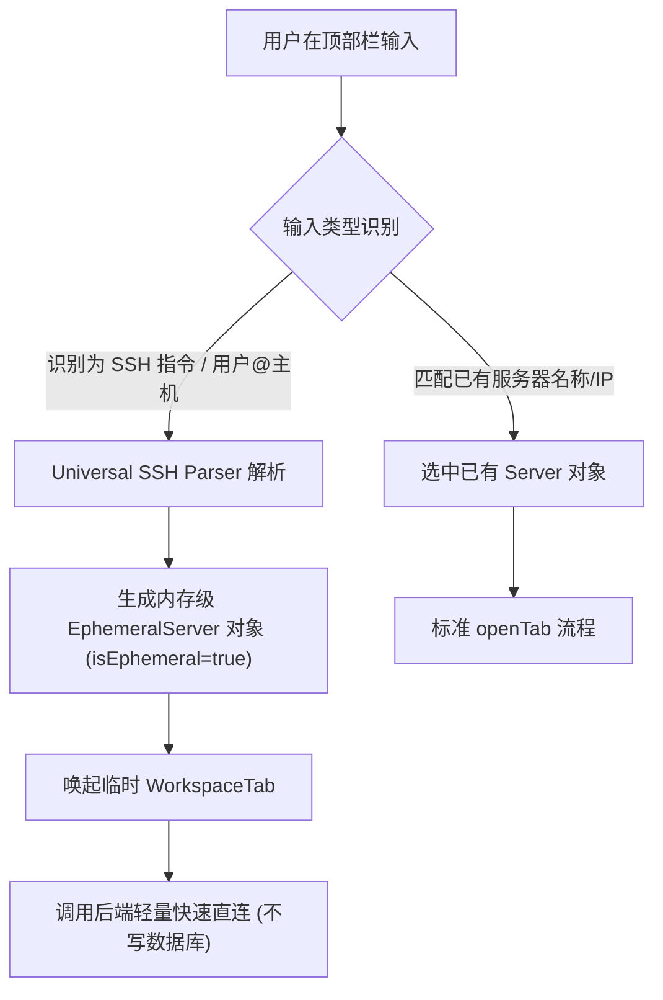

# Qshell 快捷远程连接需求与技术预研文档 (Quick Connect)

> **文档定位**：功能需求归档与技术架构预研（待办池）  
> **规划状态**：后续阶段排期实施  
> **核心原则**：当前阶段重心全力保障现有功能的系统稳定性、高并发文件传输与长会话保活；待质量全面稳定后启动本功能。

---

## 一、 功能需求梳理 (Feature Specification)

### 1. 核心定位
- **临时连接（Ephemeral Session）**：无需在服务器管理列表（SQLite DB）中持久化入库，关闭标签后自动销毁或仅保留在历史快速连接记录中；
- **双模匹配**：
  - **模式 A（本地搜索）**：输入已有主机名称/IP/标签，回车直接连接已有服务器；
  - **模式 B（指令直连）**：输入形如 `ssh user@host -p 22` 或 `user@host:port`，解析后直接拉起临时终端会话。

---

## 二、 跨平台兼容性分析 (Windows / macOS / Linux)

用户关心的指令跨平台兼容性核心在于**标准 SSH 语法与参数解析**：

| 平台 | 原生终端行为 | 本软件应支持的指令语法 | 兼容性处理方案 |
| :--- | :--- | :--- | :--- |
| **Windows** | `OpenSSH for Windows` / `cmd` / `powershell` | `ssh [-p port] [-i key] user@host` / `user@host:port` / `host:port` | 统一前端/Rust 语法解析器，屏蔽 PowerShell 与 CMD 的引号转义差异 |
| **macOS** | `OpenSSH` (BSD/macOS 默认) | 同上，且原生支持 Unix 路径 `~/.ssh/id_ed25519` | 支持展开 `~` 家目录路径，支持各种格式私钥路径映射 |
| **Linux** | `OpenSSH` (标准 GNU/Linux) | 同上，支持环境变量与复杂 flags（`-J jump`, `-X` 等） | 基础阶段支持核心连接参数（用户、主机、端口、私钥），高级参数（跳板/代理）可渐进支持 |

### 统一解析规范（通用无缝兼容）
无论用户当前跑在 Windows、macOS 还是 Linux 上，输入均统一由应用的 Command Parser 进行归一化：
1. **完整 SSH 指令**：
   - `ssh root@192.168.1.100`
   - `ssh -p 2222 root@example.com`
   - `ssh root@example.com -p 2222`
   - `ssh -i ~/.ssh/id_rsa admin@10.0.0.1`
2. **简写直连格式**：
   - `root@192.168.1.100`
   - `root@192.168.1.100:2222`
   - `192.168.1.100:22`
   - `192.168.1.100`（默认当前用户名或 root，端口 22）
3. **认证交互**：
   - 若未提供密码/私钥，自动触发既有的 `SshCredentialDialog` 弹窗轻量采集并连接，连接完成进入交互终端。

---

## 三、 架构实现方案预研（后续排期实现参考）

---

## 四、 阶段规划与优先级

- **当前阶段（Highest Priority）**：
  1. 保证 SSH 会话长连接稳定性、心跳保活、断网智能重连机制；
  2. 巩固 SFTP 传输队列、高并发分块上传/下载的容错能力；
  3. 完善分屏拖拽、多标签切换、暗黑磨砂主题渲染性能与防抖机制；
  4. 消除各平台下的边界 Bug 与内存泄漏。
- **后续规划（Backlog）**：
  - 待主流程质量全面稳定后，择期引入顶部快捷指令直连与历史会话快连功能。
