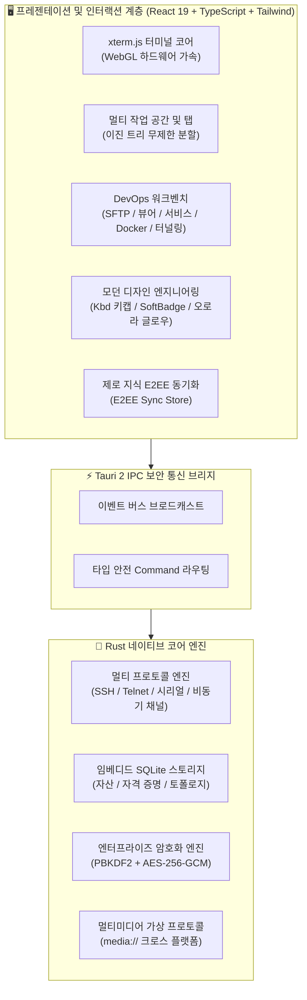

<div align="center">

<p align="center">
  
</p>

# Qshell

### 🚀 현대적인 초고속 데스크톱 터미널 및 멀티 프로토콜 서버 관리 워크벤치

<p align="center">
  <a href="../README.md"><b>English</b></a> |
  <a href="./README_zh-CN.md"><b>简体中文</b></a> |
  <a href="./README_zh-TW.md"><b>繁體中文</b></a> |
  <a href="./README_ja.md"><b>日本語</b></a> |
  <a href="./README_ko.md"><b>한국어</b></a>
</p>

[](https://github.com/Tomshushu/Qshell/releases)
[](https://gitee.com/Tom-shushu/qshell/releases)
[](https://tauri.app/)
[](https://react.dev/)
[](https://www.rust-lang.org/)
[](../LICENSE)


**초경량 고성능 · 로컬 마르코프 명령어 예측 · 세련된 긱 미학 · 제로 지식 클라우드 동기화 · 전 프로토콜 지원 · 에이전트리스 모니터링**

[🌐 GitHub Releases](https://github.com/Tomshushu/Qshell/releases) · [⚡ Gitee 고속 미러](https://gitee.com/Tom-shushu/qshell/releases) · [✨ 핵심 특징](#-qshell을-선택하는-이유-highlights) · [📖 주요 기능](#-핵심-기능-key-features) · [📦 설치 안내](#-다운로드-및-설치-download--installation) · [🤝 기여하기](../CONTRIBUTING.md)

</div>

---

## ✨ Qshell을 선택하는 이유 (Highlights)

Qshell은 **가볍고 민첩하며 안전한 올인원** 차세대 서버 관리 워크벤치로, 터미널 환경과 일상적인 DevOps 업무를 매끄럽게 연결합니다:

- ⚡ **초경량 설계와 네이티브 성능**  
  Tauri 2 + Rust 네이티브 보안 코어 기반으로 유휴 메모리 사용량이 **약 60MB**에 불과하며, 밀리초 단위의 콜드 스타트를 자랑합니다. xterm.js 및 WebGL 하드웨어 가속을 통해 100,000줄 이상의 대규모 스트리밍 로그도 프레임 드롭 없이 부드럽게 렌더링합니다.

- 🧠 **로컬 마르코프 연쇄 명령어 예측 및 OSC-7 디렉터리 감지**  
  1차 마르코프 전이 확률 모델과 터미널 OSC-7 프로토콜을 기반으로 **0ms 로컬 추론, 토큰 비용 제로, 100% 오프라인 기밀성**을 보장합니다. Git, Docker, Systemd 등 7대 엔지니어링 워크플로와 동적 인자 자동 추출(예: `mkdir` 실행 후 `cd <dir>` 추천)을 내장하였으며, 사용자의 타이핑 습관을 지속 학습하여 <kbd>Tab</kbd> 키 한 번으로 즉시 명령어를 완성합니다.

- 🎨 **최고 수준의 긱 디자인 엔지니어링 (Linear, Raycast, Cursor 표준)**  
  전면적인 UI/UX 리팩토링: 물리적 키캡의 촉감을 살린 Raycast 스타일 `<Kbd>` 컴포넌트, Linear 스타일의 은은한 소프트 배지(Soft Badges)와 `status-dot-pulse` 브리딩 인디케이터, 헤어라인 글래스모피즘, 전송률 및 프로세스 수치의 떨림을 방지하는 고정폭 숫자(`tabular-nums`)를 적용했습니다.

- 📁 **현대적인 SFTP 디렉터리 개편 및 무설치 문서 미리보기**  
  캡슐 필(Pill) 계층형 브레드크럼, 수직 격자선을 제거한 순수 헤어라인 테이블, 전용 `FolderUp` 상위 이동 행, 고병렬 재귀 전송 풀을 탑재했습니다. Word (`.docx`), Excel (`.xlsx`), PPT (`.pptx`), PDF, 코드 구문 강조, 각종 압축 파일을 별도 외부 뷰어 없이 즉시 미리볼 수 있습니다.

- 🖥️ **올인원 멀티 프로토콜 자산 허브**  
  **SSH, Telnet, 산업용 시리얼(COM), Windows 네이티브 RDP, 대역 외 관리 BMC Redfish** 프로토콜을 기본 지원합니다. 다단계 ProxyJump, SSH 터널 포트 포워딩, 트리형 계층 그룹 관리를 완벽히 지원합니다.

- 📊 **에이전트 없는 심층 시스템 관제 및 DevOps**  
  원격 서버에 별도 에이전트 데몬을 설치할 필요가 없습니다. 안전한 SSH 채널을 통해 CPU, 상세 메모리, 디스크 I/O, 네트워크 대역폭을 실시간 측정하며, **Systemd 서비스 관리**(`journalctl` 스트림 포함), 프로세스 트리, **Docker 컨테이너 수명 주기**를 손쉽게 제어합니다.

- 🔐 **제로 지식(Zero-Knowledge) E2EE 엔드투엔드 클라우드 동기화**  
  GitHub / Gitee 비공개 저장소를 활용해 기기 간 원활한 자산 동기화를 제공합니다. `PBKDF2-HMAC-SHA256 + AES-256-GCM` 군사 등급 암호화를 적용하여 마스터 비밀번호와 자격 증명이 **평문으로 클라우드에 전송되지 않습니다**.

- 🛡️ **무제한 자유 화면 분할과 쾌적한 인터랙션**  
  이진 트리 기반 무제한 멀티 페인 분할, 독립 작업 공간(Workspace), 탭 잠금 및 컬러 라벨링, 동적 비디오 배경화면 동기화, 터미널 텍스트 선택 복사 시 지연 없는 즉시 닫기 등을 제공합니다.

---

## 📖 프로젝트 소개 (Introduction)

**Qshell**은 개발자, 시스템 관리자, DevOps 엔지니어를 위해 정교하게 설계된 **현대적인 초고속 데스크톱 서버 운영 관리 워크벤치**입니다.

**Tauri 2 + Rust + React 19**를 기반으로 네이티브 하드웨어 성능을 온전히 활용합니다. 호스트 자산 관리, 멀티 프로토콜 터미널, 고병렬 SFTP 파일 관리, 에이전트리스 시스템 모니터링, Systemd 제어, Docker 오케스트레이션, SSH 터널링, 원클릭 문서 미리보기 및 **종단간 제로 지식 암호화 동기화**가 단 하나의 직관적인 워크벤치에 통합되어 있습니다.

---

## 🌟 핵심 기능 (Key Features)

### 1. ⚡ 네이티브 성능과 최신 아키텍처
- **Rust 구동 네이티브 코어**: 기존 Electron 터미널 대비 메모리 사용량 **70% 이상 절감**, 초고속 콜드 스타트.
- **WebGL 하드웨어 가속 렌더링**: GPU 기반 xterm.js 파이프라인으로 100,000줄 이상의 대용량 로그 스크롤도 버벅임 없이 처리.
- **무제한 화면 분할 (이진 트리 구조)**:
  - 탭을 뷰포트의 상/하/좌/우 모서리로 드래그하여 패널 개수 제한 없이 중첩 분할 가능;
  - 최소 화면 크기를 보장하며 마우스 드래그로 분할 비율 실시간 조절.
- **멀티 작업 공간 및 탭 보호**: 격리된 작업 공간(Workspace), 세션 복제, 탭 이름 변경, 실수 방지 잠금(Lock), 맞춤형 색상 태그 지원.

### 2. 🧠 로컬 마르코프 명령어 인텔리전스 및 OSC-7 컨텍스트
- **0ms 초고속 로컬 추론 · 토큰 비용 제로**:
  - 클라우드 LLM의 지연 시간이나 쿼터 제한 없이 **100% 로컬 기기에서 연산**;
  - 오프라인 환경이나 보안 데이터센터에서도 안전하게 작동.
- **내장된 엔지니어링 골든 플로우**:
  - **Git**: `git add .` $\xrightarrow{96\%}$ `git commit -m ""` $\xrightarrow{94\%}$ `git push`; `git pull` $\rightarrow$ `npm/pnpm install`;
  - **Docker**: `docker-compose down` $\xrightarrow{94\%}$ `docker-compose up -d` $\rightarrow$ `docker-compose logs -f`;
  - **Systemd**: `systemctl restart <svc>` $\xrightarrow{96\%}$ `systemctl status <svc>` $\rightarrow$ `journalctl -u <svc> -f`;
  - **압축 및 디렉터리**: `tar -zxvf <pkg>` $\rightarrow$ `cd <압축해제폴더>`; `df -h` $\rightarrow$ `du -sh * | sort -hr | head -n 10`.
- **동적 파라미터 슬롯 추출 및 자동 완성**:
  - 이전 명령어의 인자(경로, 서비스명, 컨테이너 ID, 브랜치명)를 똑똑하게 추출;
  - 예: `mkdir -p /data/app_v2` 실행 후 `c` 입력 시 자동으로 `cd /data/app_v2` 제안, <kbd>Tab</kbd>으로 즉시 적용.
- **OSC-7 프로토콜 기반 실시간 작업 디렉터리(CWD) 감지**:
  - 터미널 OSC-7 이스케이프 시퀀스를 실시간 분석하여 원격 셸의 현재 작업 경로를 파악;
  - `/var/log`에서는 로그 확인 명령을, 코드 저장소에서는 빌드/Git 명령을 우선 가중치 부여.
- **온라인 강화 학습 및 감쇠 모델**:
  - 명령어를 실행할 때마다 로컬에서 자동으로 학습하여 사용자의 작업 흐름에 맞게 정밀화됩니다.

### 3. 🎨 모던 디자인 시스템 및 햅틱 엔지니어링
- **촉각 키캡 컴포넌트 (`<Kbd>`)**: 베벨과 상단 하이라이트가 적용된 Raycast 스타일의 키캡으로 `xs`, `sm`, `md` 표준 규격을 확립.
- **Linear 등급 소프트 배지 및 브리딩 인디케이터**: 저채도 소프트 배지(`soft-success`, `soft-warning` 등)와 `status-dot-pulse` 브리딩 라이트를 통해 연결 상태를 세련되게 시각화.
- **헤어라인 글래스모피즘 및 플로팅 HUD**: 커맨드 팔레트(⌘K), 터미널 검색창, 우클릭 메뉴에 `inset 0 1px 0` 미세 하이라이트와 다층 안티에일리어싱 섀도 적용.
- **Cursor 스타일 오로라 글로우**: AI 어시스턴트 상단과 주요 패널에 깊이감 있는 오로라 광택을 배치하여 눈이 편안한 고급스러운 비주얼 제공.
- **고정폭 숫자(`tabular-nums`) 흔들림 방지**: SFTP 전송 속도, 프로세스 자원 지표, 시리얼 통신률, 검색 일치 카운터에 `font-mono tabular-nums`를 적용하여 숫자 변경 시 발생하는 너비 떨림 현상을 완전히 해결.

### 4. 📁 현대적인 SFTP 및 즉시 문서 미리보기
- **캡슐 필 브레드크럼**: 활성 디렉터리에 `FolderOpen` 아이콘을 표시하고 루트 및 드라이브 전환을 간편하게 지원.
- **수직선 없는 순수 헤어라인 테이블**: 엑셀형 수직 격자선을 배제하고 전용 `FolderUp` 상위 행과 `<Kbd>Alt+↑</Kbd>` 단축키 힌트를 배치.
- **고병렬 재귀 전송 풀**: 폴더의 재귀 탐색과 멀티태스킹 전송 파이프라인을 최적화하여 부드러운 대역폭 측정 제공.
- **외부 소프트웨어 없는 네이티브 문서 미리보기**:
  - 📄 **문서**: Word (`.docx`), Excel (`.xlsx`), PowerPoint (`.pptx`), PDF, Markdown;
  - 🖼️ **이미지**: PNG, JPG, WEBP, GIF, SVG, BMP, HEIC, PSD;
  - 📦 **압축 파일**: Zip, Tar, Gz, 7z, Xz 구조 탐색 및 빠른 해제;
  - 📝 **코드 및 로그**: 주요 프로그래밍 언어 구문 강조 및 경량 인플레이스 편집.

### 5. 🔐 제로 지식 E2EE 클라우드 동기화
- **전체 환경설정 동기화**: 서버 자산, 자격 증명, 그룹, SSH 키, 태그, Known Hosts 핑거프린트, 빠른 명령어, 로그 북마크 암호화 동기화.
- **동적 배경화면 동기화**: 가상 프로토콜 `media://`를 통해 맞춤형 배경 이미지 및 루프 비디오를 OS 차이 없이 완벽히 동기화.
- **암호학 사양**:
  - **NIST SP 800-132**: `PBKDF2-HMAC-SHA256` (100,000회 반복 연산 + 16바이트 암호학적 솔트);
  - **NIST SP 800-38D**: 16바이트 무결성 태그가 포함된 `AES-256-GCM` 인증 암호화;
  - **제로 지식 설계**: 마스터 비밀번호 및 원본 자격 증명은 절대 평문으로 외부에 노출되지 않습니다.

### 6. 🖥️ 멀티 프로토콜 자산 관리 및 유연한 인증
- **다양한 프로토콜 지원**:
  - **Linux / Unix**: SSH 터미널, SFTP 양방향 관리, 맞춤 테마;
  - **시리얼/COM 포트**: 산업용 시리얼 디버깅 터미널(보드레이트, 데이터 비트, 패리티, 플로우 제어, HEX/ASCII, CRC, DTR/RTS 신호 모니터링) 및 Telnet;
  - **Windows 대상**: 시스템 기본 RDP 클라이언트 원클릭 호출;
  - **BMC 원격 관리**: Redfish over HTTPS를 통한 하드웨어 상태 확인 및 원격 전원 제어.
- **SSH 터널링 (포트 포워딩)**: 로컬 포워딩 (`-L`), 원격 포워딩 (`-R`), 동적 SOCKS5 (`-D`).
- **다중 인증 체계**: 비밀번호, 암호화된 개인키, SSH 에이전트, OpenSSH 인증서, 다단계 ProxyJump.
- **서버 휴지통**: 실수 방지를 위한 소프트 삭제 및 원클릭 복구.

### 7. 📊 에이전트리스 모니터링 및 DevOps 툴박스
- **무침투 관제**: 표준 SSH 연결만을 사용하여 CPU, 상세 메모리, 디스크 I/O, 네트워크 대역폭, TCP 재전송률을 실시간 수집.
- **Systemd 관리**: Linux 서비스의 시작/중지/재시작/리로드, 부팅 시 자동 시작 설정, `journalctl` 실시간 스트리밍 로그 확인.
- **프로세스 및 포트 검사**: 프로세스 트리 자원 점유율 정렬, PID 충돌 방지 검증, 리슨 포트 시각화.
- **Docker 관리**: 컨테이너 목록, 실행 상태, 실시간 로그 스트리밍, 시작/중지 제어.
- **네트워크 종합 진단**: DNS 조회, Ping 지연율, TCP 포트 연결성, HTTP 상태 점검.

### 8. 🛡️ 엔터프라이즈 보안 및 개인정보 보호
- **애플리케이션 잠금**: 비밀번호 잠금 및 9점 패턴 잠금 듀얼 모드, 유휴 시 자동 잠금 (<kbd>Ctrl</kbd> + <kbd>Alt</kbd> + <kbd>L</kbd>).
- **위험 명령어 가드**: 대용량 스크립트 붙여넣기 시 확인 다이얼로그를 통해 악성 리버스 셸 차단.
- **호스트 키 검증**: 엄격한 SSH 호스트 키 검증 및 중간자 공격(MITM) 방지.
- **매끄러운 복사 인터랙션**: 터미널 선택 영역 복사 시 지연이나 팝업 잔상 없이 즉시 닫힙니다.

---

## 🏗️ 아키텍처



---

## 📦 다운로드 및 설치 (Download & Installation)

주요 운영체제별 공식 설치 패키지와 포터블 버전을 제공합니다:

| 운영체제 | 아키텍처 | 형식 | 고속 다운로드 (Gitee) | 글로벌 릴리스 (GitHub) |
| :--- | :--- | :--- | :--- | :--- |
| **Windows** | x86_64 / x64 | `.exe` (NSIS) | [⚡ exe 설치 파일](https://gitee.com/Tom-shushu/qshell/releases/download/v1.0.17/Qshell_1.0.17_x64-setup.exe) | [🌐 GitHub Releases](https://github.com/Tomshushu/Qshell/releases/tag/v1.0.17) |
| **macOS** | Apple Silicon (M1/M2/M3/M4) | `.dmg` | [⚡ aarch64 dmg](https://gitee.com/Tom-shushu/qshell/releases/download/v1.0.17/Qshell_1.0.17_aarch64.dmg) | [🌐 GitHub Releases](https://github.com/Tomshushu/Qshell/releases/tag/v1.0.17) |
| **macOS** | Apple Silicon (포터블) | `.app.tar.gz` | [⚡ aarch64 tar.gz](https://gitee.com/Tom-shushu/qshell/releases/download/v1.0.17/Qshell_1.0.17_aarch64.app.tar.gz) | [🌐 GitHub Releases](https://github.com/Tomshushu/Qshell/releases/tag/v1.0.17) |
| **Linux** | x86_64 / amd64 | `.AppImage` (포터블) | [⚡ AppImage](https://gitee.com/Tom-shushu/qshell/releases/download/v1.0.17/Qshell_1.0.17_amd64.AppImage) | [🌐 GitHub Releases](https://github.com/Tomshushu/Qshell/releases/tag/v1.0.17) |
| **Linux** | x86_64 / Debian/Ubuntu | `.deb` (deb 패키지) | [⚡ deb 패키지](https://gitee.com/Tom-shushu/qshell/releases/download/v1.0.17/Qshell_1.0.17_amd64.deb) | [🌐 GitHub Releases](https://github.com/Tomshushu/Qshell/releases/tag/v1.0.17) |

> 🔄 **무중단 자동 OTA 업데이트**: 이미 Qshell이 설치되어 있다면 별도 수동 재설치 없이 [설정] -> [업데이트 확인]을 통해 최적 경로에서 차분 업데이트를 받을 수 있습니다.

---

## ⌨️ 주요 단축키 가이드 (Productivity Tips)

| 단축키 (Windows/Linux) | 단축키 (macOS) | 동작 및 기능 설명 |
| :--- | :--- | :--- |
| <kbd>Ctrl</kbd> + <kbd>K</kbd> | <kbd>Cmd</kbd> + <kbd>K</kbd> | **글로벌 커맨드 팔레트** (서버 검색, 빠른 명령 실행, 테마 변경) |
| <kbd>Ctrl</kbd> + <kbd>T</kbd> | <kbd>Cmd</kbd> + <kbd>T</kbd> | 현재 활성 서버에서 **새 터미널 탭 열기** |
| <kbd>Ctrl</kbd> + <kbd>W</kbd> | <kbd>Cmd</kbd> + <kbd>W</kbd> | **활성 탭 닫기** (실수 방지 확인 팝업 지원) |
| <kbd>Ctrl</kbd> + <kbd>Tab</kbd> | <kbd>Ctrl</kbd> + <kbd>Tab</kbd> | **다음 탭**으로 순환 전환 |
| <kbd>Ctrl</kbd> + <kbd>Shift</kbd> + <kbd>Tab</kbd> | <kbd>Ctrl</kbd> + <kbd>Shift</kbd> + <kbd>Tab</kbd> | **이전 탭**으로 순환 전환 |
| <kbd>Ctrl</kbd> + <kbd>Alt</kbd> + <kbd>L</kbd> | <kbd>Cmd</kbd> + <kbd>Option</kbd> + <kbd>L</kbd> | **앱 잠금** (화면 잠금 / 비밀번호 설정) |
| <kbd>Ctrl</kbd> + <kbd>F</kbd> | <kbd>Cmd</kbd> + <kbd>F</kbd> | **터미널 검색창 열기** (고정폭 숫자 떨림 방지) |
| <kbd>Alt</kbd> + <kbd>↑</kbd> | <kbd>Option</kbd> + <kbd>↑</kbd> | **SFTP 상위 디렉터리로 이동** (전용 `FolderUp` 가이드 행) |
| <kbd>Esc</kbd> | <kbd>Esc</kbd> | 검색창 / 팔레트 / 다이얼로그를 닫고 터미널로 포커스 복귀 |
| <kbd>Ctrl</kbd> + <kbd>L</kbd> | <kbd>Cmd</kbd> + <kbd>L</kbd> | 터미널 버퍼 화면 지우기 |
| **탭을 패널 모서리로 드래그** | **탭을 패널 모서리로 드래그** | **무제한 멀티 페인 분할**: 상/하/좌/우 하이라이트 영역에 드롭 |
| **탭 우클릭 메뉴** | **탭 우클릭 메뉴** | 세션 복제, 탭 이름 변경, 잠금 보호, 컬러 태그 지정 |

---

## 🛠️ 로컬 개발 및 빌드 (Local Development)

### 1. 사전 요구 사항
- **Node.js**: `>= 18.0.0`
- **Rust 도구 체인**: `rustc >= 1.80` 및 `cargo` ([rustup.rs](https://rustup.rs/))
- **C++ 빌드 도구**:
  - Windows: Visual Studio C++ Build Tools & WebView2
  - macOS: Xcode Command Line Tools (`xcode-select --install`)
  - Linux: `libwebkit2gtk-4.1-dev build-essential curl wget libssl-dev libudev-dev`

### 2. 소스코드 복제 및 실행
```bash
# 1. 저장소 복제
git clone https://github.com/Tomshushu/Qshell.git
cd qshell

# 2. 의존성 설치
npm install

# 3. 핫 리로드 개발 모드 실행
npm run dev:tauri
```

### 3. 품질 게이트 검증
```bash
# Rust 코어 컴파일 검증
cargo check --manifest-path src-tauri/Cargo.toml

# TypeScript 정적 타입 검사
npx tsc --noEmit

# 미정의 식별자 인터셉트 검사
npm run check:undefined

# 전체 유닛 및 통합 테스트 실행
npx vitest run

# 프로덕션 빌드 미리보기
npm run build
```

---

## 🤝 기여하기 (Contributing)

커뮤니티의 모든 피드백과 기여를 진심으로 환영합니다!
- **이슈 등록**: 버그 제보나 기능 제안은 [이슈 템플릿](https://github.com/Tomshushu/Qshell/issues/new/choose)을 이용해 주세요.
- **PR 제출**: 기여 전에 [**CONTRIBUTING.md**](../CONTRIBUTING.md) 문서를 참고해 주세요.
- **릴리스 규약**: 메인테이너 릴리스 작업은 [**AGENTS.md**](../AGENTS.md) 지침을 엄격히 준수합니다.

---

## 📄 라이선스 (License)

본 프로젝트는 [Apache License 2.0](../LICENSE)에 따라 오픈소스로 배포됩니다. 저작권은 Qshell 커뮤니티에 있습니다.
