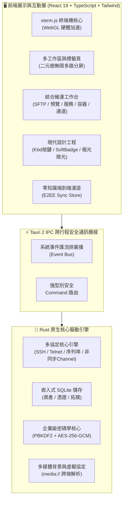

<div align="center">

<p align="center">
  
</p>

# Qshell

### 🚀 現代化極速桌面終端機與多協定伺服器管理工作台

<p align="center">
  <a href="../README.md"><b>简体中文</b></a> |
  <a href="./README_en.md"><b>English</b></a> |
  <a href="./README_zh-TW.md"><b>繁體中文</b></a> |
  <a href="./README_ja.md"><b>日本語</b></a> |
  <a href="./README_ko.md"><b>한국어</b></a>
</p>

[](https://github.com/Tomshushu/Qshell/releases)
[](https://gitee.com/Tom-shushu/qshell/releases)
[](https://tauri.app/)
[](https://react.dev/)
[](https://www.rust-lang.org/)
[](../LICENSE)


**輕量極速 · 本地馬可夫預測 · 現代極客美學 · 零知識雲漫遊 · 全協定支援 · 免 Agent 監控**

[⚡ Gitee 鏡像極速下載](https://gitee.com/Tom-shushu/qshell/releases) · [🌐 GitHub Releases](https://github.com/Tomshushu/Qshell/releases) · [✨ 核心亮點](#-為什麼選擇-qshell-highlights) · [📖 功能特性](#-核心特性與亮點-key-features) · [📦 安裝指南](#-安裝與下載-download--installation) · [🤝 參與貢獻](../CONTRIBUTING.md)

</div>

---

## ✨ 為什麼選擇 Qshell？ (Highlights)

Qshell 致力於打造一款**輕巧、敏捷、安全且全能**的新一代伺服器管理工作台，將終端機互動與日常維運場景無縫融合：

- ⚡ **極致輕量 · 原生效能**  
  基於 Tauri 2 + Rust 原生安全核心驅動，日常執行記憶體僅需 **~60MB**，冷啟動毫秒級秒開；終端機依託 xterm.js 與 WebGL 硬體加速引擎，支撐 100,000+ 行高頻捲動日誌，杜絕卡頓與掉幀。

- 🧠 **本地馬可夫鏈指令預測與 OSC-7 目錄感知**  
  基於一階馬可夫狀態轉移機率模型與終端機 OSC-7 協定，**0ms 本地計算、0 Token 開銷、100% 數據離線保密**。內建 Git、Docker、Systemd 等 7 大高頻工程連招與動態參數槽位回填（如 `mkdir` 自動推斷 `cd <dir>`），並伴隨個人擊鍵習慣自主在線學習，按 <kbd>Tab</kbd> 極速一鍵採納。

- 🎨 **對標頂級設計的極客工程 (Linear, Raycast & Cursor UI Standards)**  
  全棧重構視覺與微互動體驗：沉浸式 Raycast 觸感 `<Kbd>` 實體按鍵卡片、Linear 級柔和微透狀態徽章（Soft Badges）搭配 `status-dot-pulse` 動態呼吸指示燈、雙層髮絲級微光倒角與浮動 HUD 深度陰影；全局數字防抖（`tabular-nums`），徹底杜絕速率與效能指標的數值晃動。

- 📁 **現代化 SFTP 目錄重構與全格式開箱原生預覽**  
  高整合度 SFTP 檔案管理系統，配備全新 Raycast 風格的微藥丸雙欄路徑導覽（Capsule Breadcrumbs）、純淨無豎線髮絲表格、專屬 `FolderUp` 上級引導行與並發遞迴傳輸池；更首創免外部第三方軟體直接預覽 Word (`.docx`)、Excel (`.xlsx`)、PPT (`.pptx`)、PDF、程式碼語法醒目提示與各類壓縮包歸檔。

- 🖥️ **一站式多協定資產樞紐**  
  原生覆蓋 **SSH、Telnet、工業級 Serial 序列埠、Windows 原生 RDP 與頻外管理 BMC Redfish** 協定，支援多級鏈式跳板（ProxyJump）、SSH 通道連接埠轉發、信創國產化作業系統適配與樹狀分組拓撲，滿足從雲端主機到機房硬體的全場景連線。

- 📊 **免 Agent 深度系統感知與維運**  
  告別在遠端伺服器部署侵入式常駐 Agent 的繁瑣。基於安全 SSH 管道，開箱即得 CPU、記憶體細分、磁碟 IO、網路吞吐動態儀表板；並深度整合 **Systemd 系統服務管理**（含 journalctl 即時日誌）、行程資源拓撲與 **Docker 容器生命週期**一鍵管理。

- 🔐 **零知識 E2EE 端到端全量漫遊**  
  依託 Gitee / GitHub 私有儲存庫實現跨裝置即時漫遊。採用 `PBKDF2-HMAC-SHA256 + AES-256-GCM` 軍工級密碼學保障，主密碼與憑證**永不上雲**，安全漫遊主機資產、憑證庫、標籤拓撲乃至個性化終端機動態桌布。

- 🛡️ **自由分屏與無縫互動**  
  支援**無上限任意多路拖曳分屏**、獨立多工作區切換、標籤鎖定與彩色標記、動態影片背景跨端解析；終端機選取複製即刻消失無干擾，兼具生產力效率與賞心悅目的操作體驗。

---

## 📖 專案簡介 (Introduction)

**Qshell** 是一款面向開發者、系統管理員與 DevOps 工程師精心打造的**現代化極速桌面伺服器維運與多協定工作台**。

專案採用極簡輕量的高效能桌面架構，基於 **Tauri 2 + Rust + React 19** 構建，以原生硬體效能驅動終端機互動。Qshell 將主機資產樹、多協定終端機（SSH / Telnet / Serial / RDP / BMC Redfish）、帶並發斷點續傳的 SFTP 檔案管理、零侵入系統指標監控、Systemd 服務管理、Docker 容器編排、SSH 通道轉發、全格式檔案即時預覽與**端到端零知識加密（E2EE）全量配置漫遊**深度融合於同一個優雅直觀的工作台中。

---

## 🌟 核心特性與亮點 (Key Features)

### 1. ⚡ 極致效能與現代桌面架構
- **Rust 驅動的原生核心**：記憶體佔用較常規終端機降低 **70%+**，冷啟動秒開，極致輕巧。
- **WebGL 硬體加速渲染**：基於 xterm.js 與 GPU 渲染引擎，支撐 100,000+ 行高頻捲動日誌，杜絕主線程卡頓與掉幀。
- **無限層級自由分屏 (Unlimited Split Panes)**：
  - **無窗格數量上限**：基於二元樹動態佈局，支援將任意標籤頁拖曳到目標窗格的上下左右邊緣進行遞迴嵌套切分；
  - **彈性視口調整**：窗格間支援滑鼠拖曳即時調節比例（帶最小視口保護），適應多螢幕超寬顯示需求；
- **多工作區與標籤保護**：支援多工作區（Workspace）獨立隔離、標籤頁工作階段複製（Duplicate）、標籤重新命名、防誤觸加鎖（Lock）與自訂彩色標記；工作階段廣播與跨視窗拖曳，佈局切換時終端機實例與輸入歷史永不遺失。

### 2. 🧠 本地馬可夫鏈指令預測與 OSC-7 目錄感知 (Markov Command Intelligence & CWD Context)
- **0ms 極速本地推斷 · 零 Token 開銷**：
  - 徹底規避雲端大模型網路往返延遲（RTT）與 Token 配額限制，**100% 運行於端側本地**；
  - 嚴格離線保密，無需配置 API Key，即使在斷網環境或高密級機房依然流暢可用。
- **內建黃金工程連招拓撲 (Built-in Workflow Priors)**：
  - **Git 極速連招**：`git add .` $\xrightarrow{96\%}$ `git commit -m ""` $\xrightarrow{94\%}$ `git push`；`git pull` $\rightarrow$ `npm/pnpm install`；`git checkout -b <branch>` $\rightarrow$ `git push -u origin <branch>`；
  - **Docker & 容器編排**：`docker-compose down` $\xrightarrow{94\%}$ `docker-compose up -d` $\rightarrow$ `docker-compose logs -f`；`docker build` $\rightarrow$ `docker run -d`；
  - **Systemd 系統服務管理**：`systemctl restart <svc>` $\xrightarrow{96\%}$ `systemctl status <svc>` $\rightarrow$ `journalctl -u <svc> -f`；
  - **目錄與自動化歸檔**：`tar -zxvf <pkg>` / `unzip <pkg>` $\rightarrow$ `cd <解壓目錄>`；`df -h` $\rightarrow$ `du -sh * | sort -hr | head -n 10`；`nginx -t` $\rightarrow$ `systemctl reload nginx`。
- **動態參數槽位抽取與回填 (Slot Extraction & Propagation)**：
  - 告別死板指令補全，能夠智慧擷取前序指令中的參數（如路徑、服務名稱、容器名稱、分支名稱）；
  - 例如上一步執行 `mkdir -p /data/app_v2`，下一步鍵入 `c` 自動提取路徑並預測 `cd /data/app_v2`，按 <kbd>Tab</kbd> 一鍵成型。
- **OSC-7 協定驅動的即時工作目錄 (CWD) 感知**：
  - 深度支援終端機 OSC-7（Operating System Command 7）協定，即時毫秒級擷取遠端 Shell 目前工作目錄；
  - 依據目錄環境進行上下文隔離與加權（如 `/var/log` 下優先推薦日誌追蹤指令，程式碼倉庫下優先推薦構建與 Git 連招）。
- **端側自適應強化學習與時效衰減 (Online Self-Learning & Recency Decay)**：
  - 每次在終端機按 Enter 提交指令，本地自動學習並加權連續指令轉移對；
  - 即使是企業專屬私有腳本或自訂構建指令，執行 1~2 次後即可永久沉澱為個人專屬預測；配合時間半衰期自動遺忘陳舊指令，越用越貼合肌肉記憶。

### 3. 🎨 現代設計工程與桌面級微質感 (Modern Design System & Tactile Engineering)
- **實體觸感按鍵系統 (Tactile Keycaps)**：原生級 `<Kbd>` 規範，帶有頂部微倒角高光與暗色浮雕微邊框，在設定面板、快捷鍵說明、AI 互動與目錄導覽中全面統一。
- **Linear 級狀態微徽章 (Soft Badges & Pulse Dots)**：告別高飽和度刺眼色塊，採用柔和微透背景與 `status-dot-pulse` 動態呼吸微光，清晰區分在線、監聽、傳輸中、故障與停止狀態。
- **髮絲級雙層微光層級 (Hairline Glassmorphism)**：全局指令面板 (⌘K)、終端機搜尋 HUD、滑鼠右鍵選單與快顯彈窗注入 `inset 0 1px 0` 頂部髮絲內高光與多層抗鋸齒懸浮軟陰影。
- **Cursor 極光微光氛圍 (Subtle Aurora Glow)**：AI 助手與核心工作區注入深邃暗色極光氛圍，科技感十足且視覺柔和耐看。
- **全局數字防抖 (Tabular Figures)**：SFTP 傳輸速率、行程監控（PID/CPU/MEM/VSZ/RSS）、序列埠收發吞吐與終端機搜尋計數全量注入 `font-mono tabular-nums`，徹底杜絕字元寬度跳變帶來的視覺疲勞。

### 4. 📁 現代化 SFTP 與全格式開箱即用原生預覽
- **微藥丸雙欄路徑導覽 (Capsule Breadcrumbs)**：每一個路徑層級均為圓角懸浮膠囊，目前活躍末級目錄醒目提示並攜帶展開資料夾微圖示 (`FolderOpen`)，支援根路徑與磁碟機代號一鍵選取切換。
- **極簡髮絲排版與專屬上級導覽**：徹底摒棄傳統 Excel 風格的縱向分割豎線，採用純淨水平髮絲排版；獨立的 `FolderUp` 上級引導行與 `<Kbd>Alt+↑</Kbd>` 快捷提示，避免誤觸重新命名。
- **遞迴目錄高並發傳輸池 (Worker Pool)**：深度優化資料夾遞迴掃描與並發上傳/下載任務並發池，即時傳輸吞吐率高精平滑估算。
- **開箱即用多格式原生預覽**：無須依賴第三方外部軟體，直接在應用程式內快速預覽：
  - 📄 **文書檔案**：Word (`.docx`)、Excel (`.xlsx`)、PowerPoint (`.pptx`)、PDF、Markdown；
  - 🖼️ **圖片與向量圖**：PNG, JPG, WEBP, GIF, SVG, BMP, HEIC, PSD 等；
  - 📦 **主流壓縮包**：Zip, Tar, Gz, 7z, Xz 歸檔目錄樹互動式展開與快速解壓縮；
  - 📝 **程式碼與日誌**：支援多種主流程式語言語法醒目提示與輕量級線上快速編輯儲存。

### 5. 🔐 零知識全量端到端雲漫遊 (Zero-Knowledge E2EE Sync)
- **多維度資產無感漫遊**：完整同步伺服器配置與憑證、樹狀分組拓撲、SSH 金鑰對庫、分類標籤、已知主機信任指紋 (`Known Hosts`)、常用指令收藏庫 (`Quick Commands`) 以及日誌關鍵字書籤。
- **多媒體背景與個性化習慣漫遊**：首次支援終端機自訂背景桌布與動態影片同步，透過虛擬協定 `media://` 抹平跨作業系統路徑差異；本地 UI 風格、終端機字型字級、主題配色、快捷連線歷史與指令執行歷史換機一鍵無縫還原。
- **企業級密碼學保障**：
  - **NIST SP 800-132**：採用 `PBKDF2-HMAC-SHA256`（100,000 次高強度反覆運算 + 16 位元組高熵隨機 Salt）衍生金鑰；
  - **NIST SP 800-38D**：`AES-256-GCM` 全包認證加密與 16 位元組完整性標籤防篡改；
  - **零知識原則**：主密碼與明文憑證永不上雲，第三方託管（GitHub / Gitee 私有儲存庫）僅持有高強度密文信封；本地全量端到端加密同步資產與配置，支援 Token 與主密碼一鍵安全複製。

### 6. 🖥️ 全協定資產管理與靈活認證
- **全協定棧覆蓋**：
  - **Linux / Unix / 國產信創系統**：SSH 終端機、SFTP 雙向管理，深度適配各類主流與客製化發行版；
  - **網路硬體與序列埠 (Serial / COM)**：完備的工業級序列埠除錯終端機（傳輸速率、資料位元、停止位元、流量控制、HEX/ASCII 雙模、CRC 校驗、DTR/RTS 訊號監測、VID/PID 穩定重連）與 Telnet 工作階段；
  - **Windows 目標**：便捷調用系統原生 RDP 用戶端；
  - **伺服器頻外管理 (BMC)**：Redfish over HTTPS 協定，硬體狀態與電源遠端開關/重開機。
- **SSH 通道與連接埠轉發 (Tunneling)**：
  - 內聯支援本機轉發（Local `-L`）、遠端轉發（Remote `-R`）與動態 SOCKS5 代理轉發（Dynamic `-D`），隨伺服器連線自動建立。
- **多層次安全認證**：支援密碼、加密私密金鑰（Passphrase）、SSH Agent 身分列舉、OpenSSH 使用者憑證認證以及多級鏈式跳板代理（Multi-Hop ProxyJump）。
- **資產安全防誤觸**：內建伺服器資源回收筒（Recycle Bin），支援軟刪除與一鍵找回。

### 7. 📊 免 Agent 深度系統感知與維運工具箱
- **無侵入式監控**：遠端無需部署任何額外常駐程式或 Agent，基於安全 SSH 管道即時採集 CPU、記憶體細分、磁碟 IO、網路吞吐與 TCP 重傳率。
- **Systemd 系統服務管理**：圖形化啟停、重啟、重載 Linux 系統服務，管理開機自啟（enabled/disabled），檢視服務即時 CPU/記憶體與 `journalctl` 即時串流日誌。
- **行程與連接埠拓撲**：即時監測遠端行程樹資源佔用、依 CPU/記憶體排序，PID 衝突校驗防誤殺；視覺化探測本地與遠端監聽連接埠與網路連線。
- **Docker 容器生命週期管理**：檢視容器清單、即時狀態、串流日誌輸出、啟動/停止/重啟容器，免去手工輸入繁瑣指令。
- **網路綜合診斷工具**：一鍵執行 DNS 解析、Ping 延遲抖動、TCP 連接埠連通與 HTTP 狀態診斷。

### 8. 🛡️ 企業級安全堡壘與隱私控制
- **全能應用鎖 (Application Lock)**：支援密碼鎖與九點圖形鎖雙模式，閒置自動加鎖，斷開敏感工作階段保障機密安全（快捷鍵 <kbd>Ctrl</kbd> + <kbd>Alt</kbd> + <kbd>L</kbd>）。
- **危險操作防禦**：多行程式碼與大文字貼上二次安全確認，有效防範駭客反彈 Shell 等隱蔽腳本攻擊。
- **主機指紋防偽校驗**：嚴格驗證 SSH Host Key，支援一鍵重設與信任指紋管理，阻斷中間人攻擊 (MITM)。
- **流暢無感互動**：終端機選取複製即刻消失關閉，杜絕任何多餘互動延時與視覺噪音。

---

## 🏗️ 架構概覽 (Architecture)



---

## 📦 安裝與下載 (Download & Installation)

Qshell 為各大主流作業系統提供了開箱即用的安裝包與綠色便攜版：

| 作業系統 | 架構 | 安裝包格式 | 國內高速載點 (Gitee) | 全球發布源 (GitHub) |
| :--- | :--- | :--- | :--- | :--- |
| **Windows** | x86_64 / x64 | `.exe` (NSIS 安裝包) | [⚡ 下載 exe 安裝包](https://gitee.com/Tom-shushu/qshell/releases/download/v1.0.17/Qshell_1.0.17_x64-setup.exe) | [🌐 GitHub Releases](https://github.com/Tomshushu/Qshell/releases/tag/v1.0.17) |
| **macOS** | Apple Silicon (M1/M2/M3/M4) | `.dmg` | [⚡ 下載 aarch64 dmg](https://gitee.com/Tom-shushu/qshell/releases/download/v1.0.17/Qshell_1.0.17_aarch64.dmg) | [🌐 GitHub Releases](https://github.com/Tomshushu/Qshell/releases/tag/v1.0.17) |
| **macOS** | Apple Silicon (便攜包) | `.app.tar.gz` | [⚡ 下載 aarch64 壓縮包](https://gitee.com/Tom-shushu/qshell/releases/download/v1.0.17/Qshell_1.0.17_aarch64.app.tar.gz) | [🌐 GitHub Releases](https://github.com/Tomshushu/Qshell/releases/tag/v1.0.17) |
| **Linux** | x86_64 / amd64 | `.AppImage` (免安裝便攜版) | [⚡ 下載 AppImage](https://gitee.com/Tom-shushu/qshell/releases/download/v1.0.17/Qshell_1.0.17_amd64.AppImage) | [🌐 GitHub Releases](https://github.com/Tomshushu/Qshell/releases/tag/v1.0.17) |
| **Linux** | x86_64 / Debian/Ubuntu | `.deb` (系統安裝包) | [⚡ 下載 deb 包](https://gitee.com/Tom-shushu/qshell/releases/download/v1.0.17/Qshell_1.0.17_amd64.deb) | [🌐 GitHub Releases](https://github.com/Tomshushu/Qshell/releases/tag/v1.0.17) |

> 🔄 **全自動無感 OTA 線上升級**：已安裝 Qshell 的使用者無須手動重新下載，客戶端內建 GitHub 與 Gitee 雙通道智慧測速與 Minisign 驗簽更新引擎。在【設定】->【檢查更新】中即可一鍵完成安全差量升級。

---

## ⌨️ 常用快捷鍵與操作技巧 (Productivity Tips)

| 快捷鍵 (Windows/Linux) | 快捷鍵 (macOS) | 操作行為與功能說明 |
| :--- | :--- | :--- |
| <kbd>Ctrl</kbd> + <kbd>K</kbd> | <kbd>Cmd</kbd> + <kbd>K</kbd> | **呼出全局指令調色板** (快速檢索主機、執行操作、切換主題外觀) |
| <kbd>Ctrl</kbd> + <kbd>T</kbd> | <kbd>Cmd</kbd> + <kbd>T</kbd> | 快速在目前活躍主機上**新建終端機標籤頁** |
| <kbd>Ctrl</kbd> + <kbd>W</kbd> | <kbd>Cmd</kbd> + <kbd>W</kbd> | **關閉目前活躍標籤頁** (受保護：支援防誤觸二次確認與不再提示) |
| <kbd>Ctrl</kbd> + <kbd>Tab</kbd> | <kbd>Ctrl</kbd> + <kbd>Tab</kbd> | 循環切換至**下一個標籤頁** |
| <kbd>Ctrl</kbd> + <kbd>Shift</kbd> + <kbd>Tab</kbd> | <kbd>Ctrl</kbd> + <kbd>Shift</kbd> + <kbd>Tab</kbd> | 循環切換至**上一個標籤頁** |
| <kbd>Ctrl</kbd> + <kbd>Alt</kbd> + <kbd>L</kbd> | <kbd>Cmd</kbd> + <kbd>Option</kbd> + <kbd>L</kbd> | **一鍵鎖定應用** (呼出安全鎖屏或初次設定應用鎖) |
| <kbd>Ctrl</kbd> + <kbd>F</kbd> | <kbd>Cmd</kbd> + <kbd>F</kbd> | 呼出終端機螢幕關鍵字**醒目搜尋框** (Tabular 數字等寬防抖) |
| <kbd>Alt</kbd> + <kbd>↑</kbd> | <kbd>Option</kbd> + <kbd>↑</kbd> | **SFTP 快速返回上一級目錄** (專屬 FolderUp 引導行) |
| <kbd>Esc</kbd> | <kbd>Esc</kbd> | **關閉浮動搜尋欄 / 調色板 / 對話框**，焦點智慧無縫返還終端機 |
| <kbd>Ctrl</kbd> + <kbd>L</kbd> | <kbd>Cmd</kbd> + <kbd>L</kbd> | 清除目前終端機緩衝區螢幕內容並重設視口 |
| **滑鼠拖曳標籤頁至窗格邊緣** | **滑鼠拖曳標籤頁至窗格邊緣** | **無限多路分屏**：拖曳至窗格上/下/左/右亮點，實現任意無上限嵌套切分 |
| **標籤頁右鍵選單** | **標籤頁右鍵選單** | 工作階段快速複製、重新命名、**防誤關加鎖**、自訂彩色標記分類 |

---

## 🛠️ 本地開發與構建 (Local Development)

### 1. 前置依賴準備
- **Node.js**：`>= 18.0.0`
- **Rust 工具鏈**：`rustc >= 1.80` 與 `cargo`（[rustup.rs](https://rustup.rs/)）
- **C++ 編譯環境**：
  - Windows: Visual Studio C++ Build Tools & WebView2
  - macOS: Xcode Command Line Tools (`xcode-select --install`)
  - Linux: `libwebkit2gtk-4.1-dev build-essential curl wget libssl-dev libudev-dev`

### 2. 取得程式碼與啟動
```bash
# 1. 複製程式碼儲存庫
git clone https://github.com/Tomshushu/Qshell.git
# 或 Gitee 來源: git clone https://gitee.com/Tom-shushu/qshell.git
cd qshell

# 2. 安裝前端依賴
npm install

# 3. 啟動桌面端熱重載開發模式
npm run dev:tauri
```

### 3. 程式碼品質門禁驗證
```bash
# 執行 Rust 編譯檢查
cargo check --manifest-path src-tauri/Cargo.toml

# 執行 TypeScript 靜態型別檢查
npx tsc --noEmit

# 執行未定義識別項攔截檢查
npm run check:undefined

# 執行全量單元測試與整合測試
npx vitest run

# 執行生產環境打包預演
npm run build
```

---

## 🤝 參與貢獻 (Contributing)

我們非常歡迎社群開發者為 Qshell 貢獻程式碼或提出想法！
- **提交 Issue**：回報 Bug 或提出新需求，請直接使用我們的 [Issue 範本](https://github.com/Tomshushu/Qshell/issues/new/choose)。
- **提交 PR**：在發起程式碼合併請求前，請詳細閱讀 [**開源貢獻指南 (CONTRIBUTING.md)**](../CONTRIBUTING.md)。
- **發版標準**：核心維護者發版請嚴格遵守 [**固化發版流程規範 (AGENTS.md / GEMINI.md)**](../AGENTS.md)。

---

## 📄 開源許可證 (License)

本專案採用 [Apache License 2.0](../LICENSE) 協議開源。版權歸 Qshell 社群所有。
