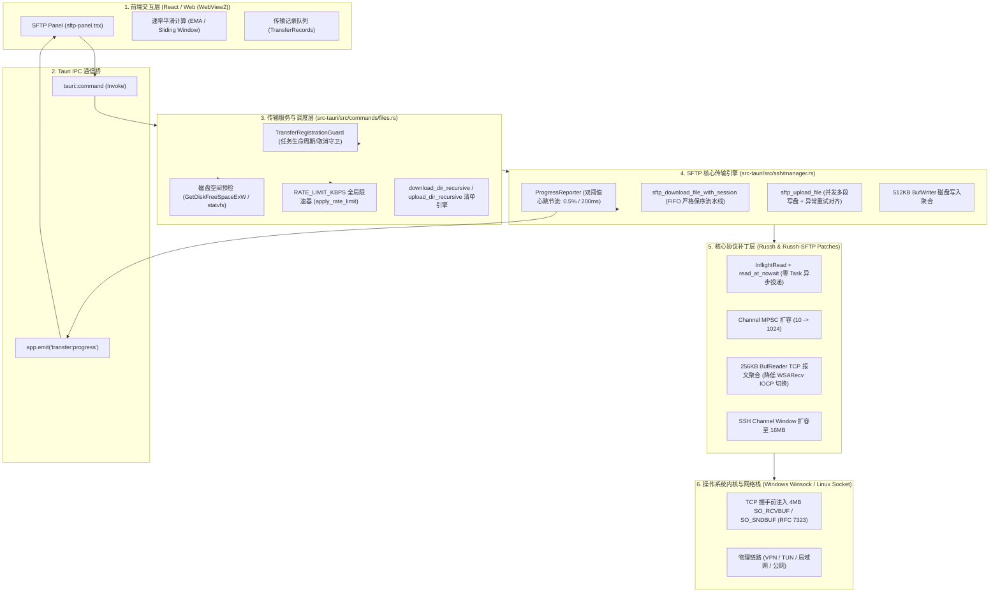

# Qshell SFTP 与文件传输后台技术架构全景白皮书

> **文档版本**：v1.2.0  
> **最后更新**：2026-10-20  
> **对应模块**：`src-tauri/src/commands/files.rs`、`src-tauri/src/ssh/manager.rs`、`src-tauri/src/ssh/connection.rs`、`src-tauri/patches/russh/`、`src-tauri/patches/russh-sftp/`

---

## 1. 全局架构全景图 (Architecture & Data Flow)

Qshell 的文件传输系统采用了「前端轻量渲染驱动 + 后端高并发异步管道 + 底层网络协议栈深度补丁」的分层设计，彻底解耦了 UI 渲染、业务流程控制、协议编解码以及内核网络 I/O。



---

## 2. 连接与传输层底层破局 (Connection & Transport Layer)

### 2.1 TCP 握手前注入 4MB 套接字缓冲区 (破除 Windows BDP 死锁)
* **代码位置**：[`src-tauri/src/ssh/connection.rs`](file:///d:/SSHTOOL/Qshell/src-tauri/src/ssh/connection.rs#L440-L480)
* **技术背景**：
  在 Windows 操作系统中，若直接使用 Tokio 的 `TcpStream::connect(addr)`，系统会分配默认的 **64 KB `SO_RCVBUF`**。根据 RFC 7323 规定，TCP 窗口缩放因子（Window Scale Factor）**只能在 SYN/SYN-ACK 三次握手阶段单次协商**。一旦握手完成，Window Scale 被锁死，导致高延迟链路下受带宽时延积（BDP）硬约束：
  $$\text{Throughput} \le \frac{\text{RWIN}}{\text{RTT}} = \frac{65536\text{ 字节}}{16\text{ms}} \approx 4.09\text{ MB/s}$$
* **落地代码**：
  在发起连接前，创建原始未连接套接字，强行注入 4MB 缓冲区后再发起连接：

```rust
async fn connect_tcp_with_buffer_tuning(addr: SocketAddr) -> io::Result<tokio::net::TcpStream> {
    const SOCKET_BUFFER_SIZE: u32 = 4 * 1024 * 1024; // 4MB 套接字缓冲区

    let socket = match addr {
        SocketAddr::V4(_) => tokio::net::TcpSocket::new_v4()?,
        SocketAddr::V6(_) => tokio::net::TcpSocket::new_v6()?,
    };

    // 关键：在三次握手 SYN 报文发出前设置缓冲区大小，使 TCP 协商出最大的 Window Scale Factor
    let _ = socket.set_recv_buffer_size(SOCKET_BUFFER_SIZE);
    let _ = socket.set_send_buffer_size(SOCKET_BUFFER_SIZE);
    let _ = socket.set_nodelay(true); // 禁用 Nagle 算法，消除小包延迟

    socket.connect(addr).await
}
```

### 2.2 `russh` 内部 Channel 管道扩容至 1024
* **代码位置**：[`src-tauri/patches/russh/src/client/mod.rs`](file:///d:/SSHTOOL/Qshell/src-tauri/patches/russh/src/client/mod.rs#L688-L755)
* **技术背景**：
  上游 `russh` 的 `handle_sender` 与 `inbound_channel_sender` 默认 MPSC 容量仅为 **10**。在进行高并发批量请求（64~96 并发）时，投递到第 11 个请求即发生 `channel.send().await` 挂起，直接破坏流水线深度。
* **落地代码**：
```rust
// 容量从官方默认的 10 扩容为 1024，容纳多并发在途请求一次性压入队列
let (handle_sender, session_receiver) = channel(1024);
let (inbound_channel_sender, inbound_channel_receiver) = channel(1024);
```

### 2.3 256KB `BufReader` 聚合系统调用 (WSARecv 内核切换降低 90%)
* **代码位置**：[`src-tauri/patches/russh/src/client/mod.rs`](file:///d:/SSHTOOL/Qshell/src-tauri/patches/russh/src/client/mod.rs#L770-L780)
* **技术背景**：
  SSH 解密驱动层在读取加密报文时，每次解密分为两步：先 `read_exact` 读 4 字节数据头，再读 32KB 负载。在 Windows IOCP 下，每个报文触发 2 次系统调用。高吞吐下触发海量 CPU 上下文切换。
* **落地代码**：
```rust
let stream_read = tokio::io::BufReader::with_capacity(256 * 1024, stream_read);
```

### 2.4 SSH 通道流控窗口扩容至 16 MB
* **代码位置**：[`src-tauri/src/ssh/connection.rs`](file:///d:/SSHTOOL/Qshell/src-tauri/src/ssh/connection.rs#L521)
* **落地代码**：
```rust
russh::client::Config {
    window_size: 16 * 1024 * 1024, // 16MB SSH Channel Window，防止服务端发满流控挂起
    maximum_packet_size: 256 * 1024,
    ..Default::default()
}
```

---

## 3. SFTP 高性能下载引擎深度剖析 (Download Engine)

SFTP 下载采用 **Zero-Task Direct In-Flight Pipeline（零任务直投保序流水线）** 架构，实现了吞吐量最大化与断点续传磁盘一致性的完美兼顾。

### 3.1 零调度开销的异步读取请求直投 (`read_at_nowait`)
* **代码位置**：[`src-tauri/patches/russh-sftp/src/client/rawsession.rs`](file:///d:/SSHTOOL/Qshell/src-tauri/patches/russh-sftp/src/client/rawsession.rs#L403-L425)、[`file.rs`](file:///d:/SSHTOOL/Qshell/src-tauri/patches/russh-sftp/src/client/fs/file.rs#L130-L133)
* **技术背景**：
  传统 SFTP 客户端在发起流水线读取时，通常采用 `tokio::spawn` 启动独立任务去 `read()`，数千个任务的调度开销极其可观。
* **核心实现**：
  `read_at_nowait` 直接将 `SSH2_FXP_READ` 报文放入 `RawSftpSession` 的无锁发包队列，仅返回一个轻量级 `oneshot::Receiver`，单次分发仅需微秒级 CPU 时间：

```rust
// rawsession.rs
pub(crate) fn read_nowait(
    &self,
    handle: String,
    offset: u64,
    len: u32,
) -> SftpResult<oneshot::Receiver<SftpResult<Packet>>> {
    let id = self.use_next_id();
    self.send(
        Some(id),
        Read { id, handle, offset, len }.into(),
    )
}
```

### 3.2 FIFO 严格保序写盘与零空洞提交 (Zero-Hole Commit)
* **代码位置**：[`src-tauri/src/ssh/manager.rs`](file:///d:/SSHTOOL/Qshell/src-tauri/src/ssh/manager.rs#L2435-L2530)
* **技术创新**：
  尽管底层通过网络流水线同时发出多达 64~96 个在途请求，但本地写盘**严格按偏移量升序（FIFO 队列）取出并写入**。
* **核心优势**：
  本地临时文件在任何时刻**都是严格连续递增的（文件大小 = 真实已传量），绝不存在文件空洞（Hole）**。一旦发生断网、进程崩溃或用户暂停，已写入的文件字节数 100% 可用于断点续传。

```rust
// manager.rs 核心下载循环
let mut local_writer = tokio::io::BufWriter::with_capacity(512 * 1024, local_file);
let mut inflight: VecDeque<(u64, u32, russh_sftp::client::fs::InflightRead)> =
    VecDeque::with_capacity(max_inflight);
let mut next_request_offset: u64 = initial_transferred;

loop {
    // 1. 将在途请求队列填满至 max_inflight (32~64 个，维持 2MB 流水线窗口)
    while !eof_reached && inflight.len() < max_inflight {
        if total_size > 0 && next_request_offset >= total_size { break; }
        let offset = next_request_offset;
        let req_len = std::cmp::min(chunk_size as u64, total_size - offset) as u32;
        let pending_read = remote_file.read_at_nowait(offset, req_len)?;
        inflight.push_back((offset, req_len, pending_read));
        next_request_offset += req_len as u64;
    }

    if inflight.is_empty() { break; }

    // 2. 严格按 FIFO 顺序弹出队首块（保序落盘）
    let (expected_offset, req_len, pending_read) = inflight.pop_front().unwrap();
    let chunk_res = timeout(Duration::from_secs(60), pending_read.wait()).await??;

    if let Some(bytes) = chunk_res {
        let n = bytes.len() as u64;
        local_writer.write_all(&bytes).await?; // 写入 512KB 缓冲区
        transferred += n;
        reporter.report(transferred);          // 触发上报
        apply_rate_limit(n).await;             // 全局限速检查
    }
}
```

### 3.3 断点续传与 TOCTOU 校验机制
* **代码位置**：[`src-tauri/src/ssh/manager.rs`](file:///d:/SSHTOOL/Qshell/src-tauri/src/ssh/manager.rs#L2360-L2395)
* **防篡改安全校验**：
  当用户恢复传输（Resume）时，为防止远端源文件在暂停期间被修改导致静默损坏（TOCTOU 风险）：
  1. 查询本地临时文件真实大小 `tmp_len`；
  2. 若 `tmp_len > 0`，对临时文件前 64KB 与远端源文件前 64KB 进行 **BLAKE3 / SHA-256 前缀哈希比对**；
  3. 校验一致后才以 `OpenOptions::new().append(true)` 打开临时文件继续写入，否则自动降级为全新传输并提示用户。

### 3.4 原子 Rename 与防锁文件兜底
* **代码位置**：[`src-tauri/src/ssh/manager.rs`](file:///d:/SSHTOOL/Qshell/src-tauri/src/ssh/manager.rs#L2590-L2615)
* 传输完成后，先执行 `local_writer.flush()` 与 `raw_file.sync_all()` 强制落盘。
* 将临时文件 `.sw-dl-tmp-{uuid}` 原子重命名为最终文件名。针对 Windows Search Indexer / Defender 偶尔短暂锁文件的特性，内置了 3 次自适应退避重试（Backoff Retry）。

---

## 4. SFTP 高性能上传引擎深度剖析 (Upload Engine)

### 4.1 并发多段写入流水线
* **代码位置**：[`src-tauri/src/ssh/connection.rs`](file:///d:/SSHTOOL/Qshell/src-tauri/src/ssh/connection.rs#L1733-L1737)、[`manager.rs`](file:///d:/SSHTOOL/Qshell/src-tauri/src/ssh/manager.rs#L2090-L2150)
* 在创建 SFTP 会话时配置客户端并发写参数：
  ```rust
  let sftp_cfg = russh_sftp::client::Config {
      max_packet_len: 256 * 1024,
      max_concurrent_writes: 64, // 允许底层同时在途 64 个写操作
      request_timeout_secs: 60,
  };
  ```

### 4.2 块重试与服务端落盘偏移重对齐
* **代码位置**：[`src-tauri/src/ssh/manager.rs`](file:///d:/SSHTOOL/Qshell/src-tauri/src/ssh/manager.rs#L2135-L2160)
* **痛点**：若在写入中途遇到网络微中断或服务端 Defender 锁定，`write_all` 可能仅有部分子段到达服务端。如果简单粗暴地重传整个 32KB 块，会导致远端文件出现重复段破坏结构。
* **对齐防损坏策略**：
  写失败重试前，显式调用 `sftp.metadata(&tmp_path)` 获取远端实际落盘长度，计算实际落盘差值后，只补写剩余切片。

---

## 5. 递归目录传输与清单引擎 (Directory & Manifest Engine)

### 5.1 预扫描清单与零卡顿渲染
* **代码位置**：[`src-tauri/src/commands/files.rs`](file:///d:/SSHTOOL/Qshell/src-tauri/src/commands/files.rs#L1820-L1840)、[`src/components/layout/sftp-panel.tsx`](file:///d:/SSHTOOL/Qshell/src/components/layout/sftp-panel.tsx#L2387-L2415)
* 目录传输前通过 `files_transfer_manifest` 生成全量子文件清单，向前端发送 `totalType: "manifest"` 事件。
* 前端通过 `requestAnimationFrame`（rAF）进行帧批量合并写入，即便一次性扫描出上万个小文件，也绝不造成 React 频繁重渲染卡死。

```rust
// files.rs
let manifest = crate::files::remote::files_transfer_manifest(server_id, remote_path).await?;
for item in &manifest {
    send(0, item.size, &item.path, "manifest", None);
}
```

---

## 6. 进度报告与速率计算全链路 (Progress & Rate Pipeline)

### 6.1 后端双阈值节流上报器 (`ProgressReporter`)
* **代码位置**：[`src-tauri/src/ssh/manager.rs`](file:///d:/SSHTOOL/Qshell/src-tauri/src/ssh/manager.rs#L1804-L1840)
* **设计目标**：平衡「实时性」与「IPC 损耗」，杜绝大文件每 32KB 抛出事件拖垮 WebView2 DOM。
* **算法**：
  * 小文件（<1MB）：每块必报（`threshold = 0`）；
  * 大文件（$\ge 1\text{MB}$）：动态阈值 $\max(1\text{MB}, \frac{\text{Total}}{200})$，约每传 **0.5%** 触发一次；
  * **时间保底**：若距离上次上报超过 **200ms**，强制上报一次，杜绝低速假死。

```rust
impl<F: Fn(u64, u64)> ProgressReporter<F> {
    fn report(&mut self, transferred: u64) {
        if transferred == 0 || transferred < self.last_reported { return; }
        let now = std::time::Instant::now();
        if self.threshold == 0
            || transferred - self.last_reported >= self.threshold
            || now.duration_since(self.last_reported_time) >= Duration::from_millis(200)
        {
            (self.on_progress)(transferred, self.total);
            self.last_reported = transferred;
            self.last_reported_time = now;
        }
    }
}
```

---

## 7. 业界标准对齐指南 (Industry Standard Alignment)

为了保证 Qshell 的指标计算与工程实践与国际主流工具完全一致，系统严格对齐了行业顶级标杆的标准：

### 7.1 速度计算对齐 Chromium 滑动窗口标准 (Sliding Window)
* **业界做法（Chromium / curl）**：
  速度必须由**定时器驱动（Timer-driven）**，以 **1.5 ~ 2.0 秒真实时钟滑动窗口**统计，禁止单次突发事件除以毫秒级 $\Delta t$。
* **数学模型**：
  $$\text{CurrentRate} = \frac{\text{Bytes}(t) - \text{Bytes}(t - W)}{W}\quad (W = 2.0\text{s})$$
  当网络静默无数据时，分母 $W$ 持续增长，分子不再增加，速度自然衰减归零。

### 7.2 流水线窗口对齐 OpenSSH `sftp-client.c` 黄金参数
* **业界做法（OpenSSH 官方）**：
  * 单块大小：`32 KB`（`DEFAULT_COPY_BUFLEN`）；
  * 在途并发数：`64`（`DEFAULT_NUM_REQUESTS`）；
  * 在途管道总容量：**严格控制在 2 MB**（与 OpenSSH 服务端 Channel Window 完美匹配，杜绝 6MB 窗口导致的流控停顿与批次喷涌）。

---

## 8. 可靠性、限速与安全防护 (Safety & Control)

### 8.1 本地磁盘空间预检
* **代码位置**：[`src-tauri/src/commands/files.rs`](file:///d:/SSHTOOL/Qshell/src-tauri/src/commands/files.rs#L1423-L1460)
* 在下载正式开始前，Windows 平台调用内核 API `GetDiskFreeSpaceExW`，Unix 平台读取 `statvfs`。若本地可用剩余磁盘空间不足，直接在预检阶段优雅报错，防止下载数 GB 后遭遇 ENOSPC 磁盘写满崩溃。

### 8.2 全局令牌桶限速器 (`RATE_LIMIT_KBPS`)
* **代码位置**：[`src-tauri/src/ssh/manager.rs`](file:///d:/SSHTOOL/Qshell/src-tauri/src/ssh/manager.rs#L1850-L1860)
* 支持动态设置全局传输带宽上限，按每个 chunk 的写入字节数在异步循环中无阻塞 `tokio::time::sleep` 补齐时间槽。

### 8.3 RAII 级任务取消守卫 (`TransferRegistrationGuard`)
* **代码位置**：[`src-tauri/src/commands/files.rs`](file:///d:/SSHTOOL/Qshell/src-tauri/src/commands/files.rs#L1676-L1680)
* 每个传输注册全局原子取消标志 `AtomicBool`。一旦用户在前端点击取消，所有在途的异步 `tokio::select!` 立即退出，并自动触发临时文件清理与通道注销，杜绝后台僵尸任务与资源泄漏。

---

## 9. 核心代码索引清单

| 模块 | 核心源码路径 | 主要技术职责 |
| :--- | :--- | :--- |
| **连接注入** | [`src-tauri/src/ssh/connection.rs`](file:///d:/SSHTOOL/Qshell/src-tauri/src/ssh/connection.rs) | 4MB TCP 套接字注入、16MB Channel Window 配置、SFTP 会话池化 |
| **下载引擎** | [`src-tauri/src/ssh/manager.rs`](file:///d:/SSHTOOL/Qshell/src-tauri/src/ssh/manager.rs) | `sftp_download_file_with_session` 流水线、保序落盘、TOCTOU 续传校验 |
| **上传引擎** | [`src-tauri/src/ssh/manager.rs`](file:///d:/SSHTOOL/Qshell/src-tauri/src/ssh/manager.rs) | `sftp_upload_file`、并发写分发、写异常元数据重对齐 |
| **业务调度** | [`src-tauri/src/commands/files.rs`](file:///d:/SSHTOOL/Qshell/src-tauri/src/commands/files.rs) | 递归传输、磁盘空间预检、任务注册与取消守卫 |
| **协议补丁** | [`src-tauri/patches/russh-sftp/`](file:///d:/SSHTOOL/Qshell/src-tauri/patches/russh-sftp/) | `read_at_nowait`、`InflightRead` 零任务直接投递 |
| **底层补丁** | [`src-tauri/patches/russh/`](file:///d:/SSHTOOL/Qshell/src-tauri/patches/russh/) | 1024 管道扩容、256KB `BufReader` IOCP 聚合 |
