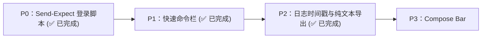

# Qshell 终端 vs Xshell 对比分析与演进规划

> **文档版本**：v1.1.2（2026-10-28 广播批量选择完整实现，含当前分屏）
> **对比标杆**：NetSarang Xshell 7 / 8
> **核实范围**：`src/components/workspace/modules/terminal.tsx`、`src/components/layout/split-layout-view.tsx`、`src/components/workspace/module-tabs.tsx`、`src/lib/session-recording.ts`、`src/i18n/locales/zh-CN.ts`

> [!NOTE]
> v1.0.0 低估了 Qshell 的现有能力，误将"广播输入、ZMODEM、关键字高亮、编码切换、动态 SOCKS5 转发、会话日志"列为缺失。本版本已逐项对照源码修正。

---

## 1. 结论概述

Xshell 的大部分核心能力 Qshell 已经具备：多终端广播输入、ZMODEM (`rz`/`sz`)、日志高亮规则、终端编码切换、动态 SOCKS5 端口转发、命令知识库驱动的智能补全、会话日志落盘、Telnet / 串口 / RDP 多协议。

**真正的剩余差距**主要是：Send-Expect 登录脚本、常驻快速命令按钮栏，以及硬件智能卡认证、脚本自动化 API 等企业级特性。

---

## 2. 功能对比矩阵

### 2.1 已对齐的能力

| 功能点 | Xshell 7/8 | Qshell 现状（已核实） |
| :--- | :---: | :--- |
| **多终端广播输入** | ✅ | ✅ 标签页与分屏顶栏均有广播开关（呼吸灯 + 目标列表提示）；键盘输入、粘贴、Tab 补全、提示项插入、Ctrl+C 均同步；串口目标自动跳过；广播按钮下拉可一键「广播到当前所有分屏」/「广播到全部标签页」/「全部取消」 |
| **广播高危命令确认** | ❌ | ✅ 广播模式下检测到高危命令时，列出受影响终端并二次确认（Qshell 独有） |
| **ZMODEM (`rz` / `sz`)** | ✅ | ✅ 集成 `zmodem.js`，含传输进度对话框 |
| **关键字高亮** | ✅ | ✅ 主题设置中的「日志高亮规则」 |
| **终端编码切换** | ✅ | ✅ 「选择终端编码」 |
| **动态 SOCKS5 转发 (-D)** | ✅ | ✅ 端口转发支持本地 / 远程 / 动态 SOCKS5 |
| **会话日志落盘** | ✅ | ✅ 开始 / 暂停 / 继续 / 停止记录，自动分卷；同时生成带时间戳的结构化会话索引（命令、工作目录、起止时间），索引中的密码 / Token 自动脱敏 |
| **多协议** | ✅ | ✅ SSH / Telnet / 串口 / RDP / BMC |
| **分屏与多标签** | ✅ | ✅ 水平 / 垂直自由分屏 |

### 2.2 Qshell 独有优势

| 功能点 | Xshell 7/8 | Qshell |
| :--- | :---: | :--- |
| **AI 运维助手** | ❌ | ✅ 自动排查、只读探针、管道命令拆解、凭据 DLP 拦截 |
| **可视化运维套件** | ❌ | ✅ Docker、进程、端口、网络、服务、SFTP 一体化 |
| **智能补全** | ❌ | ✅ 历史 + 上下文预测补全，按服务器隔离学习 |
| **跨平台** | ❌ 仅 Windows | ✅ Windows / macOS / Linux |
| **GPU 渲染与外观** | ❌ | ✅ WebGL 加速、动态背景 |
| **配置云同步** | ❌ 手动导入导出 | ✅ GitHub / Gitee 端到端加密同步 |

### 2.3 真实剩余差距

| 功能点 | Xshell 7/8 | Qshell 现状 | 影响 |
| :--- | :---: | :--- | :--- |
| **Send-Expect 登录脚本** | ✅ | ✅ **已全面超越实现**：支持声明式表格与原生异步 JS 脚本双模式；支持正则匹配 (`/pattern/i`)、本地 AES-256-GCM 硬件加密存储、宏变量替换 (`%u`, `%h`, `%p`)、延时与 `\p` 暂停序列解析、超时处置策略、以及全局默认脚本继承机制 | 🟢 堡垒机、提权、交换机自动化 |
| **常驻快速命令按钮栏** | ✅ 终端底部按钮组 | ✅ **已全面超越实现**：终端底部常驻快捷命令条，支持一键发送、回车/无回车发送、彩色高亮 Pin 标签管理、即时命令输入与全局持久化 | 🟢 高频命令秒级一键直达 |
| **脚本自动化 API** | ✅ 外部 Python / VBScript | ✅ **已全面超越实现**：原生内置标准 JavaScript 异步沙箱执行器 (`screen.waitForString`, `screen.send`, `screen.sleep`, `dialog.prompt` 等)，用户电脑免装 Python/VBScript 运行时环境即可直接运行 | 🟢 复杂多步交互任务自动化 |
| **会话日志逐行时间戳与纯文本审计导出** | ✅ 可选每行加时间戳并导出纯文本 | ✅ **已全面超越实现**：支持全局/单终端独立切换「实时毫秒时间戳前缀（`[HH:mm:ss.SSS]`）」，智能兼容 curses/alt 全屏应用（如 vim/htop 自动避让）；支持右键一键「导出纯文本审计日志（完全剔除 ANSI 乱码）」与「带时间戳日志」；支持单服务器/全局连接时「自动落盘到本地日志文件」，支持宏模版命名（`%n`, `%h`, `%p`, `%u`, `%d`, `%t`）与无 ANSI 格式清洗 | 🟢 等保与合规审计按时间检索 |
| **Compose Bar 撰写栏** | ✅ 整行输入、回车后统一分发 | ❌ 仅按键级实时同步（已有分屏广播与高危命令二次拦截） | 🟢 适合输入前需要核对完整命令的场景 |
| **PKCS#11 智能卡 / Kerberos** | ✅ | ❌ 待评估 | 🟢 金融、政企特定环境 |

---

## 3. 剩余差距说明

### 3.1 Send-Expect 登录脚本与可编程引擎（✅ 已全面完成落地）
* **实现成果**：
  1. **双模式架构**：在服务器配置中支持「规则表格模式」与「可编程 JS 脚本模式」秒级切换；
  2. **企业级安全**：数据经本地主密钥 AES-256-GCM 硬件级密文落盘，界面支持密码脱敏掩码（`isSecret`）；
  3. **高级特性补齐**：原生支持正则匹配、宏变量替换（`%u`, `%h`, `%p` 等）、发送延时与 `\p` 暂停、超时忽略/警告/强制断开策略；
  4. **全局继承与多级共享**：在设置中心支持配置「全局默认登录脚本」，单服务器可一键继承或导入全局预设；
  5. **开箱即用模板**：内置 Sudo 提权、跳板机指纹确认、网络交换机 enable、U-Boot 截停等丰富预设。

### 3.2 常驻快速命令按钮栏（✅ 已全面完成落地）
* **实现成果**：
  1. 终端底部常驻可折叠快捷命令工具条，提供快速命令输入框与回车发送；
  2. 支持 Pin 置顶常用命令，支持自定义颜色徽章标签与自动回车开关；
  3. 右键上下文菜单联动，支持一键唤起管理对话框与持久化同步。

### 3.3 会话日志逐行时间戳与纯文本审计导出（✅ 已全面完成落地）
* **实现成果**：
  1. **全协议实时时间戳注入**：SSH / Telnet / 串口 / 本地终端全量支持实时毫秒行首时间戳（`[HH:mm:ss.SSS]`）；右键菜单可一键独立切换，并在设置中心提供全局默认开关；
  2. **智能全屏应用避让保护**：终端自动监测 alternate buffer 状态（如 vim、htop、nano、less），全屏 curses 应用下自动跳过时间戳注入，退出后无缝恢复，绝不破坏光标与终端 UI；
  3. **纯文本无 ANSI 乱码一键导出**：右键菜单新增「导出纯文本日志 (无 ANSI 乱码)...」与「导出带时间戳日志...」，基于 xterm 物理单元格字符提取，100% 杜绝 `\x1b[...]` 格式乱码，直接生成等保与审计可读的 `.log` / `.txt`；
  4. **自动化会话日志落盘与宏命名**：单服务器高级配置及全局设置均支持「连接时自动开启日志落盘」，支持无 ANSI 纯文本/时间戳/原始流三种存储格式，支持自定义保存目录与 `%n`(名称)、`%h`(主机)、`%p`(端口)、`%u`(用户名)、`%d`(日期)、`%t`(时间) 宏变量模版。

### 3.4 Compose Bar 撰写栏
* **现状**：广播批量选择已完整实现（广播按钮下拉可「广播到当前所有分屏」/「广播到全部标签页」/「全部取消」，且带高危命令拦截确认）。Compose Bar 撰写栏仍未实现。
* **建议实现**：可选的 Compose Bar：底部单行输入框，回车后整行发送给所有广播目标。

---

## 4. 演进路线

* [x] **P0 Send-Expect 登录脚本与 JS 引擎**：规则列表、宏替换、延时解析、凭据加密、超时策略、全局继承（已全面完成落地）。
* [x] **P1 广播批量选择**：一键广播到全部标签页 / 全部取消 / 高危命令拦截（已实现）。
* [x] **P1 快速命令按钮栏**：终端底部常驻命令条、置顶颜色徽章、管理对话框（已全面完成落地）。
* [x] **P2 会话日志逐行时间戳与纯文本审计导出**：实时时间戳、纯文本导出、自动落盘、宏命名（已全面完成落地）。
* [ ] **P2 Compose Bar 撰写栏**。
* [ ] **待评估**：PKCS#11 智能卡。
